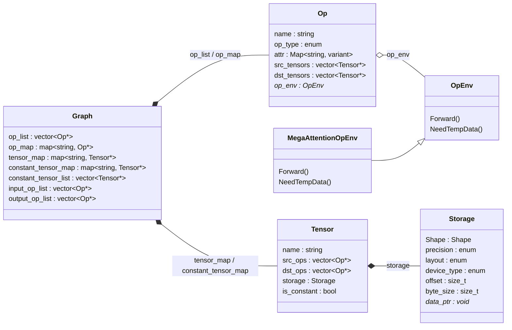

# Graph 模块设计、实施与测试

| 项目 | 内容 |
|------|------|
| 文档版本 | v1.1 |
| 日期 | 2026-11-14 |
| 文档性质 | Graph 模块设计文档（含实施与测试） |
| 代码目录 | `Graph/` |
| 验证目录 | `Build/graph/` |
| 测试报告 | [TestResults.md](../TestResults.md) |
| 配套 skill | [SKILL.md](../.skill/runtime-static-graph-cpp-pybind/SKILL.md) |

本文档是 `Graph` 模块的唯一设计文档，覆盖 IR 设计、C++ 实现、Python
绑定、构建与测试。第 3、4 章描述 IR 抽象结构与类接口，后续章节描述当前
实现提供的接口、约束、错误路径和验证方式。

## 1. 背景与目标

### 1.1 背景

推理引擎在 Python 工具链端完成：

```text
模型源码 -> Python 端静态推理图 -> 量化 / 精度推导 -> Shape 推导
        -> 显存管理 -> 序列化
```

Runtime 端在端侧 Device 上加载并执行静态图。`Graph` 是 Runtime 侧的
静态图 IR，负责回答“图里有哪些 op、tensor、常量和输入输出，它们如何连接，
按什么顺序执行”，不负责算子实现、显存分配、精度/Shape 推导或序列化。

`Graph/` 是仓库唯一的图模块：

- 同时服务于 Python 工具链构图（经 pybind11）与 Runtime 端静态图执行；
- 头文件和目标中不得出现 torch/ATen/c10，也不得依赖 GPU/OCL 算子库；
- 只与 `Runtime/common/status.h` 共享错误码与 `Status` 类型。

本文档第 3、4 章定义 `Graph`、`Op`、`Tensor`、`Storage`、`Shape`、
`GraphEnv`、`OpEnv` 和 `OpType`；C++ 实现与 pybind11 构图接口均以本文档
为准。

### 1.2 目标

| 编号 | 目标 |
|------|------|
| G-01 | 实现不依赖 torch/ATen/c10、不依赖 GPU/OCL 的 C++17 Runtime Graph IR。 |
| G-02 | 实现 `Graph` 的构图、常量/输入/输出注册、post DFS 拓扑排序和查询接口。 |
| G-03 | 实现 `GraphEnv` 共享 Storage 元信息和 `OpEnv` 执行环境接口。 |
| G-04 | 通过 pybind11 暴露 Graph/Tensor/枚举和构图接口；不暴露 Op、Storage、Shape 对象。 |
| G-05 | 提供可重复的 CMake 构建、C++ 单测、Python 单测和 CTest 集成。 |
| G-06 | 按项目规则交付设计文档、代码、真实测试结果和可复用 skill。 |

### 1.3 非目标

| 编号 | 非目标 |
|------|--------|
| NG-01 | 不实现真实 GPU/OCL kernel；`MegaAttentionOpEnv::Forward()` 只返回 `UNSUPPORTED_OP`。 |
| NG-02 | 不实现显存申请、workspace 规划、权重 H2D 拷贝和反初始化策略。 |
| NG-03 | 不实现 shape、precision、layout 的推导算法。 |
| NG-04 | 不实现模型加载、序列化/反序列化和版本兼容。 |
| NG-05 | 不实现图优化、算子融合、并发执行或流水线调度。 |
| NG-06 | 不把 Python 侧做成完整的模型构图前端；当前只暴露原生 IR 操作。 |

### 1.4 交付范围

| 交付物 | 位置 | 状态 |
|--------|------|------|
| 设计文档 | 本文档 | 已交付 |
| C++ 代码 | `Graph/include/runtime_graph/`、`Graph/src/` | 已交付 |
| Python 绑定 | `Graph/python/graph_python.cc`、`Graph/python/mobilenet_runtime_graph/` | 已交付 |
| 测试 | `Graph/tests/graph_test.cc`、`Graph/tests/test_graph.py` | 已交付并通过 |
| 测试结果 | `Graph/TestResults.md` | 已交付 |
| skill | `Graph/.skill/runtime-static-graph-cpp-pybind/SKILL.md` | 已交付 |

## 2. 需求分析

### 2.1 功能需求

| 编号 | 需求 | 验收方式 |
|------|------|----------|
| FR-01 | `Graph` 以名称为标识，独占持有 op、普通 tensor、constant tensor、GraphEnv。 | UT-C02、UT-C03、UT-P01 |
| FR-02 | `CreateOp` 创建普通计算 op 和 `out_cnt` 个输出 tensor，维护双向连接，拒绝空名称、重复名称、非法 op 类型、空输出参数、0 输出、外部 tensor。 | UT-C02、UT-C04、UT-P02、UT-P09 |
| FR-03 | `CreateConstant` 创建无 producer op 的 constant tensor，保存 Storage，强制 `reusable=false`，并加入常量列表。 | UT-C02、UT-P03 |
| FR-04 | `CreateInput` 支持 legacy 和显式 precision/layout 两种重载；输入 op 与输入 tensor 同名，登记到输入列表，`attr["storage"]` 保存声明。 | UT-C02、UT-P04、UT-P06 |
| FR-05 | `CreateOutput` 创建只消费已有 tensor、不产生新 tensor 的输出 op，登记到输出列表。 | UT-C02、UT-P02 |
| FR-06 | `SortOp` 从输出 op 出发做 post DFS，生成拓扑序 `op_list_`，constant 作为依赖叶子，不进入执行序列；重复调用结果稳定。 | UT-C02、UT-P02、UT-P08 |
| FR-07 | 提供常量、输入 op、输出 op、执行序列的只读查询。 | UT-C02、UT-C03、UT-P02 |
| FR-08 | `GraphEnv` 以名称为键注册和查询共享 Storage，拒绝空名称和重复名称。 | UT-C03 |
| FR-09 | `OpEnv` 提供 `Init`、`Forward`、`NeedTempData`；`MegaAttentionOpEnv` 作为派生示例。 | UT-C03 |
| FR-10 | Python 绑定暴露 Graph、Tensor、Precision、Layout、DeviceType、OpType 和构图/排序/dump 接口；不暴露 Op、Storage、Shape。 | UT-P01 至 UT-P10 |
| FR-11 | `dump_ir` 输出确定性的 inputs/constants/ops/outputs 文本，不输出真实指针。 | UT-P01 至 UT-P08 |
| FR-12 | `mobilenet_runtime_graph` 公共包可从源码树或 `GRAPH_PYTHON_DIR` 加载扩展。 | UT-P10 |
| FR-13 | CMake 构建静态库、Python 扩展、C++ 单测并注册 CTest。 | TR-01、TR-02 |

### 2.2 非功能需求

| 编号 | 需求 | 落地方式 |
|------|------|----------|
| NFR-01 | Runtime Graph 不依赖 torch/ATen/c10 和 GPU/OCL 库。 | 源文件与头文件不 include 相关头文件；CMake 只链接 `Runtime/common/status.cc`。 |
| NFR-02 | C++ 代码遵守 Google Style，新增行不超过 80 显示列。 | 命名、缩进、include 顺序自检；脚本按东亚字符宽度检查。 |
| NFR-03 | 所有模块、类、函数有中文注释，覆盖功能边界、输入输出、主要逻辑。 | 逐文件检查，文件头、类、函数均有注释。 |
| NFR-04 | 错误通过 `Status` 返回，不依赖异常表达可预期错误；Python 边界统一转异常。 | C++ 返回 `INVALID_ARGUMENT`/`STATE_ERROR`；pybind 转 `RuntimeError`/`ValueError`。 |
| NFR-05 | 图对象所有权清晰，禁止悬空引用。 | `unique_ptr` 持有，列表保存非拥有裸指针；Tensor 绑定使用 `reference` 策略并文档化生命周期。 |
| NFR-06 | 输出确定性，便于逐行断言和回归。 | `std::map` 保证属性顺序；列表保留注册顺序；`StorageToString` 不打印指针值。 |
| NFR-07 | 构图和排序在单线程完成；不承诺线程安全。 | 类注释明确说明；不加锁，避免隐藏同步成本。 |
| NFR-08 | 构建可在无 MSVC 的 Windows 环境完成。 | CMake + Ninja + Zig C++ 包装脚本；归档器可配置。 |

### 2.3 约束条件

| 编号 | 约束 |
|------|------|
| C-01 | C++17，禁止 RTTI 之外的非标准扩展；当前使用 `std::variant`、`std::map`、`std::unique_ptr`。 |
| C-02 | 复用 `mobilenet::Status` 和 `mobilenet::ErrorCode`，不重复定义错误模型。 |
| C-03 | 命名空间为 `mobilenet::runtime_graph`，避免与 `Graph/` 工具链模块冲突。 |
| C-04 | 构图期权重地址由调用方提供，Graph 不复制权重数据。 |
| C-05 | Python 侧最低版本 3.10；本地验证使用 Python 3.13.3。 |
| C-06 | `kMaxShapeDim=8`，超过 8 维的 shape 在 Python 入口拒绝。 |

### 2.4 验收标准

| 编号 | 验收标准 |
|------|----------|
| AC-01 | 干净构建 16/16 目标成功，无编译警告。 |
| AC-02 | C++ 单测返回 0，输出 `graph_test: ALL TESTS PASSED`。 |
| AC-03 | Python 单测 10/10 通过，覆盖正常构图、排序、dump 和错误路径。 |
| AC-04 | CTest 2/2 通过，退出码为 0。 |
| AC-05 | `_graph` 扩展可在 Python 中导入，公共包可加载并导出相同类型。 |
| AC-06 | 设计文档、代码、测试结果、skill 四件套齐全且相互可追溯。 |

## 3. 概要设计

### 3.1 模块定位与 IR 结构

#### 3.1.1 模块定位

Graph 模块负责 C++ runtime IR、构图和图遍历。`Graph` 是该模块对外提供的核心类，持有模型拓扑、op、tensor、constant、输入输出和必要索引等 IR 公共成员，并定义构图、输入输出注册、排序和查询接口。Graph 不直接依赖底层 GPU/OCL 算子库，也不负责显存申请、shape / precision / layout 推导的具体策略。

Graph 构图完成后调用一次 `SortOp()` 整理 graph 内部 op 列表：从 graph 输出出发，沿 tensor 依赖关系执行 post DFS，将 graph op 按拓扑顺序放入 `op_list_`；constant 权重直接表示为 `Tensor`，作为数据依赖叶子，不进入执行序列。后续 Engine 初始化通过 `GetAllConstantTensor()` 处理权重，通过 `GetOrderlyOPList()` 消费执行序列，初始化阶段不再重复排序。

#### 3.1.2 IR 结构



Graph IR 的核心对象包括：

- `Graph`：保存整个模型或子图。
- `Op`：表示一次计算、输入、输出或 runtime 边界操作。
- `Tensor`：表示 op 之间的数据依赖边。
- `Storage`：描述 tensor 或 tempdata 的物理存储信息；constant 权重 storage 内嵌在 constant tensor 中。
- `GraphEnv`：保存 graph 级全局共享环境资源，例如 graph 内只需要一份的共享 buffer storage；Manager 统一为这些 storage 分配和回填 workspace。
- `OpEnv`：表示挂在 op 上的运行时执行环境；`MegaAttentionOpEnv` 是具体 op env 示例。

### 3.2 分层结构

```text
+-------------------------------------------------------------+
| Python 模型加载 / 测试脚本                                   |
|   mobilenet_runtime_graph（公共包，转发到 _graph）      |
+------------------------------+------------------------------+
                               | pybind11
+------------------------------v------------------------------+
| _graph 扩展                                            |
|   Graph / Tensor / 枚举绑定；Status -> Python 异常            |
+------------------------------+------------------------------+
                               | C++17 API
+------------------------------v------------------------------+
| runtime_graph 静态库                                         |
|   Graph -> Op -> OpEnv                                      |
|   Graph -> Tensor -> Storage -> Shape                        |
|   Graph -> GraphEnv -> Storage                               |
+------------------------------+------------------------------+
                               | 仅 Status
+------------------------------v------------------------------+
| Runtime/common/status.h                                      |
+-------------------------------------------------------------+
```

依赖方向严格向下：上层可以依赖下层，下层不能反向依赖 pybind、torch 或
GPU/OCL。

### 3.3 目录与职责

| 路径 | 职责 |
|------|------|
| `include/runtime_graph/types.h` | `Precision`、`Layout`、`DeviceType`、`kMaxShapeDim`、名称/字节数查询。 |
| `include/runtime_graph/shape.h` | 定长 `dims`/`pitch`、逻辑元素数和物理元素数计算。 |
| `include/runtime_graph/storage.h` | Shape、Precision、Layout、DeviceType、offset、byte_size、data_ptr、reusable。 |
| `include/runtime_graph/attr.h` | `AttrValue` variant、`AttrMap`、稳定文本格式化。 |
| `include/runtime_graph/tensor.h` | 数据边、producer/consumer、内嵌 Storage、constant 标记。 |
| `include/runtime_graph/op.h` | 节点、属性、输入输出连接、OpEnv 生命周期。 |
| `include/runtime_graph/op_type.h` | 全部算子枚举和 `OpTypeToStr`。 |
| `include/runtime_graph/op_env.h` | 执行环境抽象和 `MegaAttentionOpEnv` 示例。 |
| `include/runtime_graph/graph_env.h` | graph 级共享 Storage 表。 |
| `include/runtime_graph/graph.h` | 图根对象、构图、图边界、排序和查询。 |
| `src/*.cc` | 与头文件一一对应的实现。 |
| `python/graph_python.cc` | pybind11 绑定和属性类型转换。 |
| `python/mobilenet_runtime_graph/__init__.py` | 公共包加载器，导出原生类型和枚举。 |
| `tests/graph_test.cc` | C++ 单元测试。 |
| `tests/test_graph.py` | Python 单元测试。 |
| `tools/` | CMake + Zig 本地构建包装脚本。 |
| `CMakeLists.txt` | 静态库、扩展、测试和 CTest 注册。 |

### 3.4 所有权关系

```text
Graph
 ├── op_map_              : map<string, unique_ptr<Op>>       （拥有）
 ├── tensor_map_          : map<string, unique_ptr<Tensor>>   （拥有）
 ├── constant_tensor_map_ : map<string, unique_ptr<Tensor>>   （拥有）
 ├── graph_env_           : unique_ptr<GraphEnv>              （拥有）
 ├── op_list_             : vector<Op*>                       （借用）
 ├── constant_tensor_list_: vector<Tensor*>                   （借用）
 ├── input_op_list_       : vector<Op*>                       （借用）
 └── output_op_list_      : vector<Op*>                       （借用）

Op
 ├── src_tensors_ : vector<Tensor*>   （借用，Graph 保证生命周期）
 ├── dst_tensors_ : vector<Tensor*>   （借用，Graph 保证生命周期）
 └── op_env_      : unique_ptr<OpEnv> （拥有）

Tensor
 ├── src_ops_ : vector<Op*>   （借用）
 ├── dst_ops_ : vector<Op*>   （借用）
 └── storage_: Storage        （值语义，不拥有 data_ptr）

OpEnv
 ├── op_        : Op*         （借用）
 └── graph_env_ : GraphEnv*   （借用，可为空）
```

关键不变量：

1. `Tensor` 只由 `tensor_map_` 或 `constant_tensor_map_` 之一持有，不会同时
   存在于两者中。
2. constant tensor 没有 producer op，`is_constant_=true`，`storage_.reusable`
   被强制为 `false`。
3. 普通 tensor 至少有一个 producer op；输入 tensor 的 producer 是 input op。
4. 执行序列只包含从输出可达的 op，constant 不产生执行节点。
5. `Graph` 析构函数先对所有 op 调用 `ClearOpEnv()`，再让成员逆序析构，确保
   派生 `OpEnv` 的析构逻辑不会访问已经释放的 `GraphEnv`；`OpEnv` 本身不
   拥有 `Op` 或 `GraphEnv`。

### 3.5 关键流程

#### 3.5.1 构图流程

```text
CreateConstant -> 校验名称/Shape -> 建 Tensor -> 写 Storage
               -> reusable=false -> constant 列表/索引
CreateInput    -> 校验 op/tensor 名称 -> 建 input op + tensor
               -> attr["storage"] -> input 列表/索引
CreateOp       -> 校验名称/输出参数/op 类型/源 tensor
               -> 预生成并校验全部输出 tensor 名
               -> 建 op -> 连接 src/dst -> 注册索引 -> 返回输出
CreateOutput   -> 校验 op 名称/输入 tensor 归属
               -> 建 kOutput op -> 连接 input -> output 列表/索引
```

所有 `Create*` 都先完成校验再提交，避免失败时留下半成品节点。

#### 3.5.2 排序流程

```text
SortOp:
  clear op_list_
  if output_op_list_ empty -> STATE_ERROR
  states = {}
  for output_op in output_op_list_:
      VisitOp(output_op, states)
  return OK

VisitOp(op, states):
  state = states[op]            // 0 未访问，1 访问中，2 已完成
  if state == 1 -> 依赖环
  if state == 2 -> 返回
  state = 1
  for tensor in op.SrcTensors:
      if tensor == null -> STATE_ERROR
      if tensor.IsConstant -> continue
      if tensor.SrcOps empty -> STATE_ERROR
      for producer in tensor.SrcOps:
          VisitOp(producer, states)
  state = 2
  op_list_.push_back(op)
```

结果是 post-order：producer 先于 consumer，input op 位于最前，output op 位于
最后。

#### 3.5.3 Python 调用流程

```text
Python 调用 graph.create_op(...)
  -> pybind 解析 list[Tensor*] 和 attr dict
  -> ToAttrMap 把 bool/int/float/str/list/tuple 转成 AttrValue
  -> Graph::CreateOp
  -> 失败：ThrowIfError 抛 std::runtime_error -> Python RuntimeError
  -> 成功：按 reference 策略返回 Tensor 句柄列表
```

### 3.6 技术选型与取舍

| 主题 | 选择 | 理由 | 代价 |
|------|------|------|------|
| 属性容器 | `std::variant` + `std::map` | 支持有限类型集合，顺序稳定，无第三方依赖 | 每增加类型需改 `AttrValue` 和格式化分支 |
| 对象所有权 | `unique_ptr` + 非拥有裸指针 | 所有权唯一，执行序列重建成本低 | 裸指针生命周期需文档和测试约束 |
| 拓扑排序 | 从输出出发的递归 post DFS | 只访问可达子图，天然跳过常量 | 递归深度受图深度限制，超大图需改迭代 |
| Python 绑定 | pybind11 | 与 C++ 类型映射直接，异常转换简单 | 需显式管理 Tensor 非拥有句柄 |
| Python 公共包 | 薄加载器 | 兼容源码树和构建目录，不复制图逻辑 | 安装到 site-packages 时默认路径失效 |
| 构建 | CMake + Ninja | 跨平台，易注册 CTest | 无 MSVC 时需 Zig 包装和归档器覆盖 |
| 错误模型 | 复用 `Status` | 与 Runtime 其他模块一致 | Python 只保留消息，错误码未单独暴露 |

## 4. 详细设计

### 4.1 公共类型

#### 4.1.1 `Precision` / `Layout` / `DeviceType`

- `Precision`：`kUnknown`、`kFloat64`、`kFloat32`、`kFloat16`、`kBFloat16`、
  `kFloat8E4M3`、`kFloat8E5M2`、`kInt64`、`kInt32`、`kInt16`、`kInt8`、
  `kUInt8`、`kBool`。
- `Layout`：`kRowMajor`、`kColumnMajor`。
- `DeviceType`：`kUnknown`、`kHost`、`kDevice`。
- `PrecisionByteSize` 返回单元素字节数；未知类型返回 0。
- `PrecisionName` / `LayoutName` / `DeviceTypeName` 返回稳定的小写字符串，
  供 `StorageToString` 和测试使用。

#### 4.1.2 `Shape`

`Shape` 描述 tensor 的逻辑维度和物理 pitch。逻辑维度用于 shape 推导和元素数量计算；pitch 描述每个维度实际占用的物理大小，用于需要按物理布局估算存储大小的场景。

- `dims`、`pitch` 为 `std::array<int64_t, kMaxShapeDim>`，默认全部为 1。
- `max_dim` 默认 0，表示空 shape，此时元素数为 1。
- `GetShapeSize()` 返回 `dims[0, max_dim)` 的乘积；`GetByteSize()` 返回
  `pitch[0, max_dim)` 的乘积。
- 越界、负维度、`int64_t` 乘法溢出返回 `-1`。
- `GetByteSize()` 的名称沿用基础设计，实际语义是“物理 pitch 元素数”，
  不是字节数；真实字节数由 `Storage::byte_size` 表达。

##### 4.1.2.1 结构体定义

`Shape` 使用长度为 `kMaxShapeDim` 的定长数组保存 `dims` 和 `pitch`，默认值均为 1；`max_dim` 表示实际有效维度数量，放在数组成员之后。

```cpp
// Shape 描述 tensor 的逻辑维度和物理 pitch。
struct Shape {
    // 返回逻辑 shape 的元素数量。
    int64_t GetShapeSize() const;

    // 返回物理 pitch 对应的元素数量。
    int64_t GetByteSize() const;

    std::array<int64_t, kMaxShapeDim> dims;
    std::array<int64_t, kMaxShapeDim> pitch;
    int64_t max_dim;
};
```

#### 4.1.3 `Storage`

`Storage` 描述 tensor、constant 或 tempdata 的物理存储信息，包括 shape、precision、layout、workspace offset、byte size、data pointer 和是否允许复用。它是 Finalizer 推导结果、Manager 显存规划结果和 OpEnv 底层算子调用参数之间的共同载体。

| 字段 | 类型 | 默认值 | 语义 |
|------|------|--------|------|
| `shape` | `Shape` | 空 shape | 逻辑维度和物理 pitch。 |
| `precision` | `Precision` | `kUnknown` | 元素精度。 |
| `layout` | `Layout` | `kRowMajor` | 逻辑布局。 |
| `device_type` | `DeviceType` | `kUnknown` | `data_ptr` 当前所在设备类别。 |
| `offset` | `size_t` | 0 | workspace 内逻辑偏移，当前约定为字节。 |
| `byte_size` | `size_t` | 0 | 当前 storage 字节数。 |
| `data_ptr` | `void*` | `nullptr` | 非拥有数据地址。 |
| `reusable` | `bool` | `true` | 是否允许参与 workspace 复用。 |

`StorageToString` 输出固定字段顺序，不输出真实地址，只输出
`data=set`/`data=unset`，便于逐字符串断言。

##### 4.1.3.1 结构体定义

`Storage` 是只保存数据描述的结构体，不定义复杂行为。它内嵌在 Tensor 中，也用于 OpEnv tempdata。模型加载完成后，constant tensor storage 可以临时指向 Python torch tensor 持有的 CPU 权重；`Engine.Init()` 的 `RealizeConstantWeights()` 阶段会为 constant 申请 GPU 显存，拷贝权重，并把 constant tensor storage 的 `data_ptr` 更新为 GPU 地址。

```cpp
// Storage 描述 tensor 或 constant 的物理存储信息。
struct Storage {
    Shape shape;
    Precision precision;
    Layout layout;
    DeviceType device_type;
    size_t offset;
    size_t byte_size;
    void *data_ptr;
    bool reusable;
};
```

#### 4.1.4 `AttrValue` / `AttrMap`

`AttrValue` 支持：

```cpp
bool
int64_t
double
std::string
std::vector<int64_t>
std::vector<double>
std::vector<std::string>
Storage
```

`AttrMap` 为 `std::map<std::string, AttrValue>`，因此 `dump_ir` 中属性按
key 字典序输出。数组格式为 `[a,b]`，布尔为 `true`/`false`。

### 4.2 `Graph` 接口与行为

#### 4.2.1 Graph 类结构

##### 4.2.1.1 主要功能

`Graph` 是 runtime graph IR 的根对象，负责承载一个模型或子图的拓扑结构。它统一管理 op、普通 tensor、constant tensor、图输入输出、拓扑排序结果和 graph 级共享环境资源，并向模型加载模块、Engine 初始化流程和 Forward 流程提供稳定的 graph 查询接口。

Graph 只表达“图是什么”和“图中对象如何连接”，不直接执行底层 kernel，也不负责显存申请、通信初始化或具体 shape / precision / layout 推导策略。这些运行时工作分别由 Engine、Finalizer、Manager 和 OpEnv 完成。

##### 4.2.1.2 类如何设计

`Graph` 设计为 C++ graph IR 核心类。公共接口用于构图、注册图边界、排序和查询；公共 IR 成员放在 `protected` 区域，便于后续扩展实现复用。跨模块访问优先通过明确接口完成，避免外部模块直接依赖内部容器细节。

Graph 内部使用 `map<string, unique_ptr<Op>>`、`map<string, unique_ptr<Tensor>>` 等容器持有 op、普通 tensor 和 constant tensor 的生命周期；执行序列、constant tensor 列表、输入 op 列表和输出 op 列表只保存裸指针，指向这些容器中已经创建好的对象，不负责释放对象。constant tensor 由 `constant_tensor_map_` 独立持有，不写入普通 `tensor_map_`。Graph 最后放置 `std::unique_ptr<GraphEnv> graph_env_`，用于保存 graph 级共享资源的 storage 元信息；Engine 初始化阶段通过 `CreateEnv()` 申请 GraphEnv 并创建 OpEnv，具体 OpEnv 通过 `OpEnv::Init()` 保存的 `graph_env_` 指针访问这些共享资源，Manager 通过 GraphEnv 遍历所有 share data 并统一规划 workspace。

```cpp
// Graph 是 runtime IR 的核心类，负责构图、图边界注册、拓扑排序和 IR 查询。
class Graph {
public:
    // 创建指定名称的 graph。
    explicit Graph(const std::string &name);

    // 返回 graph 名称。
    virtual const std::string &Name() const;

    // 创建普通计算 op，并返回该 op 创建出的输出 tensor。
    virtual Status CreateOp(
        const std::string &name,
        const std::vector<Tensor*> &src_tensors,
        size_t out_cnt,
        OpType op_type,
        const AttrMap &attr,
        std::vector<Tensor*> *outputs);

    // 创建 constant tensor，并把传入 storage 保存到 tensor 内。
    virtual Status CreateConstant(
        const std::string &name,
        const Storage &storage,
        Tensor **output);

    // 创建 graph 输入 op，并注册到 graph 输入列表；name 表示输入名称。
    virtual Status CreateInput(const std::string &name, Tensor **output);

    // 创建 graph 输出 op，并注册到 graph 输出列表；name 表示输出名称，input 表示输出依赖的 tensor。
    virtual Status CreateOutput(const std::string &name, Tensor *input);

    // 根据 graph 输出依赖整理 op 列表；constant tensor 作为依赖叶子，不进入 op_list_。
    virtual Status SortOp();

    // 返回所有 constant tensor。
    virtual const std::vector<Tensor*> &GetAllConstantTensor();

    // 返回所有输入 op。
    virtual const std::vector<Op*> &GetAllInputOp();

    // 返回所有输出 op。
    virtual const std::vector<Op*> &GetAllOutputOp();

    // 返回拓扑排序后的执行 op 序列。
    virtual const std::vector<Op*> &GetOrderlyOPList();

    // 设置 graph 级共享环境资源，并接管所有权。
    virtual Status SetGraphEnv(std::unique_ptr<GraphEnv> graph_env);

    // 返回 graph 级共享环境资源；未创建时返回 nullptr。
    virtual GraphEnv *GetGraphEnv();

    // 清理 graph 级共享环境资源。
    virtual void ClearGraphEnv();

    virtual ~Graph() = default;

protected:
    // 检查 tensor 指针是否由当前 graph 持有。
    bool OwnsTensor(const Tensor *tensor) const;

    std::string name_;
    std::vector<Op*> op_list_;
    std::vector<Tensor*> constant_tensor_list_;
    std::vector<Op*> input_op_list_;
    std::vector<Op*> output_op_list_;
    std::map<std::string, std::unique_ptr<Op>> op_map_;
    std::map<std::string, std::unique_ptr<Tensor>> tensor_map_;
    std::map<std::string, std::unique_ptr<Tensor>> constant_tensor_map_;
    std::unique_ptr<GraphEnv> graph_env_;
};
```

##### 4.2.1.3 接口和成员含义

| C++ 接口 | Python wrapper | 参数 | 说明 |
|---|---|---|---|
| `Graph()` | - | `name`：graph 名称。 | 创建指定名称的 graph，并保存到 `name_`。 |
| `Name()` | - | 无。 | 返回 graph 名称。 |
| `CreateOp()` | `create_op()` | `name`：op 名称；`src_tensors`：输入 tensor 列表；`out_cnt`：输出 tensor 数量；`op_type`：op 类型；`attr`：op 属性；`outputs`：输出参数，返回创建出的输出 tensor。 | 创建普通计算 op 和输出 tensor；op 名称由 `Op` 构造函数保存，tensor 名称由 `Tensor` 构造函数保存。 |
| `CreateConstant()` | `create_constant()` | C++：`name`、`storage`、`output`；Python：`name`、`dims`、`pitch`、`precision`、`layout`、`byte_size`、`data_ptr`。 | C++ 接口创建 constant tensor，并将权重 storage 直接保存到该 tensor 内；Python wrapper 不暴露 `Storage`，而是在 wrapper 内由散装参数组装 storage。 |
| `CreateInput()` | `create_input()` | legacy：`name`、`output`；显式声明 overload：额外传 `precision`、`layout`。 | 创建 input op 和一个输出 tensor并注册图输入；legacy 给 Input attr 写默认 `Storage{}`，显式 overload 把 precision/layout 写入该 attr。Python `Tensor(..., dtype=..., is_input=True)` 通过 `mark_input(name, dtype)` 调用显式接口。 |
| `CreateOutput()` | `create_output()` | `name`：输出名称；`input`：输出依赖的输入 tensor。 | 创建 output op 并注册图输出；output op 没有输出 tensor，因此不调用 `CreateOp()`，也不写入 `tensor_map_`。 |
| `SortOp()` | `sort_op()` | 无。 | 从 graph 输出出发，沿 tensor 依赖关系执行 post DFS，将 graph op 按拓扑顺序放入 `op_list_`；constant tensor 作为依赖叶子，不要求 producer op。 |
| `GetAllConstantTensor()` | - | 无。 | 返回 graph 中所有由 `CreateConstant()` 创建的 constant tensor，供 Engine 初始化阶段加载权重。 |
| `GetAllInputOp()` | - | 无。 | 返回 graph 中所有输入 op 的列表，供输入绑定和初始化检查使用。 |
| `GetAllOutputOp()` | - | 无。 | 返回 graph 中所有输出 op 的列表，供输出绑定和初始化检查使用。 |
| `GetOrderlyOPList()` | - | 无。 | 返回 `SortOp()` 生成的 graph 拓扑排序 op 序列；调用方不能修改执行序列容器，但可通过 `Op*` 修改 op 内容。 |
| `SetGraphEnv()` | - | `graph_env`：Engine 创建出的 graph 级共享环境资源。 | 设置 graph 级共享环境资源，并接管所有权。 |
| `GetGraphEnv()` | - | 无。 | 返回 graph 级共享环境资源指针，未创建时返回 `nullptr`；供 Engine `CreateEnv()` 创建 OpEnv 时传入。 |
| `ClearGraphEnv()` | - | 无。 | 清理 graph 级共享环境资源，供 Engine `Uninit()` 反序释放环境时调用。 |
| - | `dump_ir()` | 无。 | Python binding 只读调试接口，返回 IR 文本，用于 Graph / 模型加载测试和人工确认；不暴露 `Op`、`Storage`、`Shape` 对象。 |

`CreateOp(name, src_tensors, out_cnt, op_type, attr, outputs)` 是普通算子的构图入口。它调用 `Op` 构造函数创建普通计算 op，由 `Op` 自己保存 `name`、`op_type` 和 `attr`；再根据 `out_cnt` 调用 `Tensor` 构造函数创建输出 tensor，由 `Tensor` 自己保存 tensor 名称；随后维护输入 tensor 到当前 op、当前 op 到输出 tensor 的连接关系，并把 op / tensor 注册到 graph 索引结构，最后通过 `outputs` 返回输出 tensor。

`CreateConstant(name, storage, output)` 是 C++ 权重常量构图入口。Python binding 不暴露 `Storage` / `Shape` 类型，Python 侧 `create_constant()` 传入权重名称、dims、pitch、precision、layout、byte size 和 CPU data pointer；pybind wrapper 内部组装 C++ `Storage` 后调用 `CreateConstant()`。C++ 侧创建名为 `name` 的 constant tensor，把传入 storage 直接保存到该 tensor 内，将 storage `reusable` 置为 false，并设置 `tensor->IsConstant()` 标记。constant tensor 不创建 producer op，由 `constant_tensor_map_` 独立持有，并追加到 `constant_tensor_list_`。权重常量作为图中的普通数据依赖被后续 op 消费，后续 OpEnv 从输入 tensor storage 读取权重地址和元信息。`Engine.Init()` 的 `RealizeConstantWeights()` 阶段会把 constant tensor storage 从 CPU 指针更新为 GPU 指针。

`CreateInput(name, output)` 是 legacy 图输入入口：C++ 创建 input op 和输出 tensor，给 Input op 写入默认 `attr["storage"] = Storage{}`，并登记到 `input_op_list_`。`CreateInput(name, precision, layout, output)` 复用同一拓扑创建过程，再把构图期 precision/layout 写入 Input attr；此时输出 tensor 仍保持默认 Storage，Finalizer 读取 attr 后才同步 tensor 元信息。Python `Tensor(name=..., dtype=..., is_input=True)` 由 `mark_input(name, dtype)` 调用显式 pybind overload，首版 layout 固定 dense；legacy 调用仍由 Engine Init 回退到 Int64/dense。

`CreateOutput(name, input)` 创建 output op 时写入默认 `attr["storage"] = Storage{}`。Input / Output op 的 `"storage"` attr key 是稳定边界属性；Input 还用它承载构图期 precision/layout 声明。Engine `SetInput()` / `SetOutput()` 在 Init 或 Forward 时覆盖 attr 的值，解绑时恢复为默认 `Storage{}`，不移除该 key。

`CreateOutput(name, input)` 是图输出的构图入口。output op 只消费已有 tensor，不产生新的 tensor，因此 C++ 侧手动创建 `OpType::kOutput` op，维护 `input -> output op` 的连接关系，注册到 `op_map_` 和 graph 输出列表，但不调用 `CreateOp()`，也不向 `tensor_map_` 写入输出 tensor。

`SortOp()` 以 `output_op_list_` 中登记的图输出为起点，沿 tensor 的 producer 依赖关系执行 post DFS。遍历过程中，graph op 按拓扑依赖顺序放入 `op_list_`，供初始化和 Forward 使用；遇到 `tensor->IsConstant()` 为 true 的 constant tensor 时，将其视为依赖叶子，不要求 `SrcOps()` 非空，也不压入 producer op。构图阶段 op 真正存放在 `op_map_` 中，`op_list_` 只保存排序整理后的非拥有指针。

Python binding 额外提供 `dump_ir()` 只读调试接口，内部读取 graph 排序结果并格式化成文本。该接口仅用于测试和人工确认，不作为 runtime 初始化的数据交换边界，也不向 Python 暴露 C++ `Op`、`Storage`、`Shape` 类型或返回这些对象的查询接口。

| 成员 | 类型 | 含义 |
|---|---|---|
| `name_` | `string` | graph 名称，用于调试和 graph_map 索引。 |
| `op_list_` | `vector<Op*>` | `SortOp()` 后生成的 graph 拓扑排序 op 序列，不拥有 op 生命周期。 |
| `constant_tensor_list_` | `vector<Tensor*>` | `CreateConstant()` 创建出的 constant tensor 列表，供 Engine 加载权重阶段遍历。 |
| `input_op_list_` | `vector<Op*>` | 图输入边界 op 列表；保留注册顺序，供输入绑定和初始化检查使用。 |
| `output_op_list_` | `vector<Op*>` | 图输出边界 op 列表；保留注册顺序，供输出绑定、初始化检查和 `SortOp()` 依赖遍历起点使用。 |
| `op_map_` | `map<string, unique_ptr<Op>>` | Graph 中持有 op 生命周期的容器，key 为 op 名称。 |
| `tensor_map_` | `map<string, unique_ptr<Tensor>>` | Graph 中持有 tensor 生命周期的容器，key 为 tensor 名称。 |
| `constant_tensor_map_` | `map<string, unique_ptr<Tensor>>` | Graph 中持有 constant tensor 生命周期的容器，key 为常量名称。 |

#### 4.2.2 `CreateOp`

```cpp
Status CreateOp(const std::string& name,
                const std::vector<Tensor*>& src_tensors,
                size_t out_cnt, OpType op_type,
                const AttrMap& attr,
                std::vector<Tensor*>* outputs);
```

校验顺序：

1. op 名称非空且未被 `op_map_` 占用；
2. `outputs != nullptr`；
3. `out_cnt > 0`；
4. `op_type` 不是 `kUnknown`、`kInput`、`kOutput`；
5. 每个源 tensor 非空，且属于当前 graph 的 `tensor_map_` 或
   `constant_tensor_map_`；
6. 预生成全部输出 tensor 名称，并确认未被
   `tensor_map_`/`constant_tensor_map_` 占用。

只有全部校验通过后才创建 op 和 tensor。连接关系为：

- `op.src_tensors_ += src_tensors`；
- 每个源 tensor 的 `dst_ops_ += op`；
- 每个输出 tensor 的 `src_ops_ += op`；
- `op.dst_tensors_ += output`。

#### 4.2.3 `CreateConstant`

```cpp
Status CreateConstant(const std::string& name,
                      const Storage& storage, Tensor** output);
```

- 名称必须在 tensor 命名空间中唯一；
- `output` 非空；
- `storage.shape.GetShapeSize() >= 0`；
- 复制 Storage，强制 `reusable=false`；
- 不创建 producer op，不写入 `tensor_map_`；
- 追加到 `constant_tensor_list_` 和 `constant_tensor_map_`。

`byte_size`、`data_ptr`、`precision` 与 shape 的一致性由调用方保证；当前
实现不交叉校验，这是有意的信任边界。

#### 4.2.4 `CreateInput`

legacy：

```cpp
Status CreateInput(const std::string& name, Tensor** output);
```

显式重载：

```cpp
Status CreateInput(const std::string& name, Precision precision,
                   Layout layout, Tensor** output);
```

公共实现 `CreateInputInternal`：

1. 校验 op 名称和 tensor 名称（同名、均在各自命名空间唯一）；
2. 校验 `output` 非空；
3. 创建 `kInput` op 和同名 tensor；
4. `op.dst_tensors_ += tensor`，`tensor.src_ops_ += op`；
5. `attr["storage"]` 写入默认 `Storage{}` 或显式 precision/layout；
6. 登记 `input_op_list_`、`op_map_`、`tensor_map_`。

输入 tensor 的 Storage 自身仍保持默认；构图期声明的 precision/layout 只在
input op 的 attr 中，供 Finalizer 后续同步。

#### 4.2.5 `CreateOutput`

```cpp
Status CreateOutput(const std::string& name, Tensor* input);
```

- 校验输出 op 名称非空且未占用；
- 校验 `input` 属于当前 graph；
- 创建 `kOutput` op，写入默认 `attr["storage"] = Storage{}`；
- `op.src_tensors_ += input`，`input.dst_ops_ += op`；
- 不创建输出 tensor，不写 `tensor_map_`；
- 登记 `output_op_list_` 和 `op_map_`。

#### 4.2.6 `SortOp`

- 每次调用先清空 `op_list_`，支持重复排序；
- 没有输出 op 返回 `STATE_ERROR`；
- 对每个输出 op 执行 `VisitOp`；
- `VisitOp` 使用 `std::map<const Op*, int>` 记录 0/1/2 状态；
- 遇到常量跳过 producer；
- 遇到非 const 且无 producer 的 tensor 返回 `STATE_ERROR`；
- 遇到 null tensor/op 返回 `STATE_ERROR`；
- 发现状态 1 返回依赖环错误；
- 状态 2 直接返回，避免重复加入；
- 访问完成后压入 `op_list_`。

由于公开构图接口只能“消费已有 tensor、产生新 tensor”，正常情况下无法
构造出环；环检测是防御性分支，供未来反序列化或内部构建路径使用。

#### 4.2.7 查询与 GraphEnv

- `GetAllConstantTensor()` 返回 `constant_tensor_list_`；
- `GetAllInputOp()` 返回 `input_op_list_`；
- `GetAllOutputOp()` 返回 `output_op_list_`；
- `GetOrderlyOPList()` 返回排序后的 `op_list_`；
- `SetGraphEnv(nullptr)` 返回 `INVALID_ARGUMENT`，成功时接管所有权；
- `GetGraphEnv()` 未设置返回 `nullptr`；
- `ClearGraphEnv()` 释放 GraphEnv；
- `SetGraphEnv` 只应在 Engine 初始化阶段调用一次；如果在既有 OpEnv 仍持有
  `graph_env_` 时替换或清理 GraphEnv，会留下悬空指针，调用方必须先
  `ClearOpEnv`。

### 4.3 `Op` / `Tensor` / `OpEnv`

#### 4.3.1 `Op`

##### 4.3.1.1 Op 主要功能

`Op` 表示 graph 中的一个节点，可以是普通计算、输入、输出或 runtime 边界操作。它记录自身类型、属性、输入输出 tensor 连接关系，以及 Engine 初始化后挂载的 `OpEnv`。

Op 不直接拥有 tensor，也不直接申请 runtime 显存。它通过 `src_tensors_` / `dst_tensors_` 描述数据依赖，通过 `attr_` 保存算子静态属性，通过 `op_env_` 持有具体执行环境。


- 构造函数保存名称、类型、属性副本；
- `SetAttr` 拒绝空属性名，同名覆盖；
- `SetOpEnv(nullptr)` 返回 `INVALID_ARGUMENT`，成功时替换并销毁旧 OpEnv；
  调用方不得继续持有旧 OpEnv 指针，Engine 初始化阶段应只绑定一次；
- `ClearOpEnv()` 释放执行环境；
- `AddSrcTensor` / `AddDstTensor` 为私有，只允许 `Graph` 调用；空指针被忽略，
  但 `Graph` 在调用前已经拒绝空源 tensor。

##### 4.3.1.2 Op 类定义

`Op` 作为 Graph 内部对象由 `Graph::op_map_` 统一持有生命周期。Graph 构图阶段通过 `Op` 构造函数创建 Op，并在构造时设置 `name_`、`op_type_` 和 `attr_`；随后 Graph 把相关 tensor 连接到 Op。Engine 初始化阶段根据 `op_type_` 为普通计算 op 创建对应 `OpEnv`。

```cpp
// Op 表示 graph 中的一个计算节点或边界节点。
class Op {
public:
    // 创建指定名称、类型和属性的 op。
    Op(const std::string &name, OpType op_type, const AttrMap &attr);

    // 返回 op 名称。
    const std::string &Name() const;

    // 返回 op 类型。
    OpType Type() const;

    // 返回 op 属性。
    const AttrMap &Attrs() const;

    // 设置 op 属性。
    Status SetAttr(const std::string &attr_name, const AttrValue &value);

    // 返回输入 tensor 列表。
    const std::vector<Tensor*> &SrcTensors() const;

    // 返回输出 tensor 列表。
    const std::vector<Tensor*> &DstTensors() const;

    // 绑定 runtime 执行环境并接管所有权。
    Status SetOpEnv(std::unique_ptr<OpEnv> op_env);

    // 清理 runtime 执行环境。
    void ClearOpEnv();

    // 返回 runtime 执行环境。
    OpEnv *GetOpEnv() const;

private:
    friend class Graph;

    // 添加输入 tensor 连接。
    void AddSrcTensor(Tensor *tensor);

    // 添加输出 tensor 连接。
    void AddDstTensor(Tensor *tensor);

    std::string name_;
    OpType op_type_ = OpType::kUnknown;
    AttrMap attr_;
    std::vector<Tensor*> src_tensors_;
    std::vector<Tensor*> dst_tensors_;
    std::unique_ptr<OpEnv> op_env_;
};
```

##### 4.3.1.3 Op 接口与成员

| 接口 | 参数 | 说明 |
|---|---|---|
| `Op()` | `name`：op 名称；`op_type`：op 类型；`attr`：op 属性。 | 创建 op，并初始化 `name_`、`op_type_` 和 `attr_`。 |
| `Name()` | 无。 | 返回 op 名称，用于 graph 索引、日志和调试。 |
| `Type()` | 无。 | 返回 op 类型，Engine 初始化时据此选择对应 `OpEnv`。 |
| `Attrs()` | 无。 | 返回 op 属性，供 Finalizer、Manager 或 OpEnv 读取算子静态配置。 |
| `SetAttr()` | `attr_name`：属性名；`value`：属性值。 | 设置 op 属性，供 Engine 在运行期用输入输出绑定 storage 覆盖 Input / Output op 的 `attr["storage"]`。 |
| `SrcTensors()` | 无。 | 返回输入 tensor 列表。 |
| `DstTensors()` | 无。 | 返回输出 tensor 列表。 |
| `SetOpEnv()` | `op_env`：runtime 执行环境 unique_ptr。 | 绑定 Engine 初始化阶段创建的 op env，并接管对象所有权。 |
| `ClearOpEnv()` | 无。 | 释放已绑定的 op env，供 Engine `Uninit()` 反初始化流程调用。 |
| `GetOpEnv()` | 无。 | 返回已绑定的 op env，Forward 阶段调用其执行入口。 |

| 成员 | 类型 | 含义 |
|---|---|---|
| `name_` | `string` | op 名称，用于 graph 索引和调试。 |
| `op_type_` | `enum` | op 类型，如 input、output、attention、linear、rmsnorm、moe、gather、add、add_rmsnorm、ffn 等。 |
| `attr_` | `Map<string, variant>` | op 属性，只保存图结构和执行所需的算子属性。 |
| `src_tensors_` | `vector<Tensor*>` | 输入 tensor。 |
| `dst_tensors_` | `vector<Tensor*>` | 输出 tensor。 |
| `op_env_` | `unique_ptr<OpEnv>` | runtime 初始化后创建的算子执行环境，由 Op 持有生命周期。 |

`op_type` 决定 `Engine.Init()` 阶段应创建哪一种 `OpEnv`。普通计算 op 的 `attr_` 保存静态或半静态属性，例如 RMSNorm 的 `eps`、attention 的 head 配置、axis、是否 causal 等。权重名称、host/device 大块内存和 runtime buffer 不由普通计算 op 的 `attr_` 承载，应通过 constant tensor 的 `Storage` 或显存管理模块管理。Input / Output op 例外：构图时会预置 `attr["storage"] = Storage{}`；Engine 的 `SetInput()` / `SetOutput()` 会覆盖该值，供 InputOpEnv / OutputOpEnv 在 Forward 阶段读取；解绑时恢复默认值。

#### 4.3.2 OpType 设计

`OpType` 表示 graph 节点类型，用于模型加载阶段构图、Engine 初始化阶段选择 `OpEnv`，以及日志和调试输出。枚举值遵循 C++ scoped enum 风格，成员名以 `k` 开头。

```cpp
// OpType 表示 graph 中 op 的类型。
enum class OpType {
    kUnknown,
    kInput,
    kOutput,
    kMegaAttention,
    kLinear,
    kLinearRmsNorm,
    kLinearRmsNormRope,
    kLinearRmsNormRopeQuantPagedKVStore,
    kLinearRopeRotateQuant,
    kLinearMul,
    kLinearApe,
    kRmsNorm,
    kRmsNormRopeQuantPagedKVStore,
    kRopeQuantLinear,
    kMegaMoe,
    kDeepseekV3Router,
    kHashRouter,
    kScoreRouter,
    kLinearSwiGlu,
    kGather,
    kExpandEmbedding,
    kAdd,
    kAddRmsNorm,
    kFfn,
    kHcPre,
    kHcPost,
    kHcHead,
    kRope,
    kSparseMla,
    kQuant,
    kRotate,
    kKvCompress,
    kIndexScore,
    kTopK,
    kReshape,
    kPack,     // pack [B,S_max,*rest] -> [M,*rest] by input_start_index (gather valid tokens)
    kUnpack,   // unpack [M,*rest] -> [B,S_max,*rest] by input_start_index (scatter + pad 0)
};

// 返回 op 类型对应的字符串名称。
const char *OpTypeToStr(OpType op_type);
```

| 接口 / 枚举 | 含义 |
|---|---|
| `kInput` / `kOutput` | graph 输入输出边界 op。 |
| `kMegaAttention` | MegaAttention 大粒度融合算子，覆盖 attention / MLA / KV cache 相关路径。 |
| `kLinear` | linear 算子，对应底层 GEMM 路径。 |
| `kLinearRmsNorm` / `kLinearRmsNormRope` / `kLinearRmsNormRopeQuantPagedKVStore` | DeepSeek V4 Tcore-Vcore 构图使用的 Q/KV path 通用融合 op。 |
| `kLinearRopeRotateQuant` / `kLinearMul` / `kLinearApe` | DeepSeek V4 Tcore-Vcore indexer / compressor 前段使用的通用融合 op。 |
| `kRmsNorm` | RMSNorm 算子。 |
| `kRmsNormRopeQuantPagedKVStore` / `kRopeQuantLinear` | DeepSeek V4 Tcore-Vcore compressor 后段和 output path 使用的通用融合 op。 |
| `kMegaMoe` | MegaMoe 大粒度融合算子，覆盖 routed expert 的 dispatch / grouped GEMM / combine 路径，不包含 router 和 shared expert。 |
| `kDeepseekV3Router` / `kHashRouter` / `kScoreRouter` | MoE 路由融合 op，分别覆盖 DeepSeek V3 router、DeepSeek V4 hash layer tie2eid 路径和 V4 普通 score+bias+topk 路径。 |
| `kLinearSwiGlu` | Expert / shared expert 的 gate + up + SwiGLU 前段融合 op。 |
| `kGather` | gather 算子。 |
| `kExpandEmbedding` | DeepSeek V4 使用的 embedding lookup + HC 维展开融合算子。 |
| `kAdd` | add 算子。 |
| `kAddRmsNorm` | add + RMSNorm 融合算子。 |
| `kFfn` | FFN 相关融合算子。 |
| `kHcPre` / `kHcPost` / `kHcHead` | DeepSeek V4 Hyper-Connections 相关 op。 |
| `kRope` / `kQuant` / `kRotate` / `kReshape` | DeepSeek V4 attention 拆分后的基础变换 op。 |
| `kSparseMla` | DeepSeek V4 sparse MLA attention 内核 op。 |
| `kKvCompress` / `kIndexScore` / `kTopK` | DeepSeek V4 compressor / indexer 路径使用的 domain op 和通用 top-k op。 |
| `OpTypeToStr()` | 将 `OpType` 转为稳定字符串，供日志、错误信息和调试输出使用。 |

#### 4.3.3 `Tensor`

##### 4.3.3.1 Tensor 主要功能

`Tensor` 表示 op 之间的数据依赖边。它连接 producer op 和 consumer op，并携带该 tensor 对应的 `Storage` 描述，使 Finalizer、Manager 和 OpEnv 能够围绕同一个数据对象完成 shape / precision / layout 推导、显存规划和底层算子调用。

Tensor 不拥有计算逻辑，也不直接决定显存分配策略。它只记录数据流关系和物理存储描述，是 graph 拓扑分析和 workspace 生命周期分析的基础对象。


- `SrcOps()` / `DstOps()` 返回只读连接列表；
- `GetStorage()` 提供可写和只读重载；
- `Reusable()` / `SetReusable()` 读写 `storage_.reusable`；
- `IsConstant()` 返回 `is_constant_`；
- `AddSrcOp` / `AddDstOp` / `SetConstant` 为私有，只允许 `Graph` 调用；
- `ref_count_` 当前保留为生命周期分析字段，尚未在 `SortOp` 中使用。

##### 4.3.3.2 Tensor 类定义

普通 activation tensor 由 `Graph::tensor_map_` 持有生命周期，constant tensor 由 `Graph::constant_tensor_map_` 持有生命周期。Graph 构图阶段通过 `Tensor` 构造函数创建 Tensor，并在构造时设置 `name_`。普通计算 op 创建输出 tensor，`CreateConstant()` 创建 constant tensor，输入输出边界 op 通过 tensor 与后续计算节点连接。Tensor 内嵌 `Storage`，workspace tensor 的 `Storage.data_ptr` 在显存规划和 realize 后指向 workspace GPU 地址；constant tensor 的 storage 在权重加载后指向 GPU 权重地址。

```cpp
// Tensor 表示 graph 中的数据边，并承载对应 storage 描述。
class Tensor {
public:
    // 创建指定名称的 tensor。
    explicit Tensor(const std::string &name);

    // 返回 tensor 名称。
    const std::string &Name() const;

    // 返回 producer op 列表。
    const std::vector<Op*> &SrcOps() const;

    // 返回 consumer op 列表。
    const std::vector<Op*> &DstOps() const;

    // 返回 tensor 的 storage。
    Storage &GetStorage();

    // 返回 tensor 的只读 storage。
    const Storage &GetStorage() const;

    // 返回 tensor storage 是否允许参与 workspace 复用。
    bool Reusable() const;

    // 设置 tensor storage 是否允许参与 workspace 复用。
    void SetReusable(bool reusable);

    // 返回 tensor 是否为 constant 权重 tensor。
    bool IsConstant() const;

private:
    std::string name_;
    std::vector<Op*> src_ops_;
    std::vector<Op*> dst_ops_;
    Storage storage_;
    int ref_count_;
};
```

##### 4.3.3.3 Tensor 接口与成员

| 接口 | 参数 | 说明 |
|---|---|---|
| `Tensor()` | `name`：tensor 名称。 | 创建 tensor，并初始化 `name_`。 |
| `Name()` | 无。 | 返回 tensor 名称，用于 graph 索引、日志和调试。 |
| `SrcOps()` | 无。 | 返回 producer op 列表，普通 tensor 通常只有一个 producer。 |
| `DstOps()` | 无。 | 返回 consumer op 列表，供遍历、依赖分析和生命周期分析使用。 |
| `GetStorage()` | 无。 | 返回 tensor storage，供推导、显存规划和 OpEnv 执行阶段读取或更新。 |
| `Reusable()` | 无。 | 返回 `storage_.reusable`，表示 tensor 的物理内存是否允许参与 workspace 复用。 |
| `SetReusable()` | `reusable`：是否允许复用。 | 写入 `storage_.reusable`，用于显式标记 tensor workspace 生命周期。 |

| 成员 | 类型 | 含义 |
|---|---|---|
| `name_` | `string` | tensor 名称。 |
| `src_ops_` | `vector<Op*>` | 产生该 tensor 的上游 op，普通 tensor 通常只有一个 producer。 |
| `dst_ops_` | `vector<Op*>` | 消费该 tensor 的下游 op。 |
| `storage_` | `Storage` | tensor 内嵌的物理存储描述。 |
| `ref_count_` | `int` | workspace 规划期用于生命周期分析的消费者引用计数。 |
| `is_constant_` | `bool` | 标记该 tensor 是否为 constant 权重 tensor。 |

Tensor 不直接拥有计算逻辑。它承接 graph 数据流，提供依赖分析、生命周期分析和显存复用分析所需的信息。

#### 4.3.4 `OpEnv`

- `OpEnv(Op*)` 保存所属 op；
- `Init(GraphEnv*)` 默认只保存指针并返回 OK，允许 `graph_env=nullptr`；
- `Forward()` 纯虚，由派生类实现；
- `NeedTempData()` 纯虚，表示是否需要临时 workspace；
- `MegaAttentionOpEnv::Forward()` 返回 `UNSUPPORTED_OP`；
- `MegaAttentionOpEnv::NeedTempData()` 返回 `true`。

### 4.4 Python 绑定

#### 4.4.1 暴露面

| Python 符号 | 类型 | 说明 |
|-------------|------|------|
| `Graph` | class | 构造参数 `name`；提供 `create_op`、`create_constant`、`create_input`、`create_output`、`sort_op`、`dump_ir`。 |
| `Tensor` | class | 只读 `name`、`is_constant`、`reusable`；方法 `set_reusable`。 |
| `Precision` | enum | 全部精度值。 |
| `Layout` | enum | 行主序/列主序。 |
| `DeviceType` | enum | unknown/host/device。 |
| `OpType` | enum | 与 C++ 枚举一一对应。 |

不暴露 `Op`、`Storage`、`Shape`、`GraphEnv`、`OpEnv`。

#### 4.4.2 属性转换

| Python 值 | C++ `AttrValue` |
|-----------|-----------------|
| `bool` | `bool` |
| `int` | `int64_t` |
| `float` | `double` |
| `str` | `std::string` |
| `list[int]` / `tuple[int]` | `std::vector<int64_t>` |
| `list[float]` / `tuple[float]` | `std::vector<double>` |
| `list[str]` / `tuple[str]` | `std::vector<std::string>` |
| `[]` | 空 `std::vector<int64_t>` |
| `None`（attr 整体） | 空 `AttrMap` |

拒绝：其他标量类型、数字与字符串混合数组、非字符串 key、非 dict 的 attr。

#### 4.4.3 错误映射

- `Graph::Create*`、`SortOp` 返回的 `Status` 失败：
  `ThrowIfError` 抛出 `std::runtime_error`，Python 侧捕获为 `RuntimeError`；
- 参数/属性类型转换失败：抛出 `std::invalid_argument`，Python 侧为
  `ValueError`；
- Python 当前不区分 `ErrorCode`，只保留错误消息。后续如需程序化处理，可增加
  异常类型或错误码属性。

#### 4.4.4 生命周期

- `Tensor` 以 `py::return_value_policy::reference` 返回，不转移所有权；
- Python 必须保证 `Graph` 比所有 `Tensor` 句柄存活更久；
- `create_constant` 只保存 `data_ptr`，不复制数据；调用方必须保证缓冲区在
  Graph 使用该权重期间有效；
- 模块 docstring 和公共包 docstring 均写明该约束。

#### 4.4.5 `dump_ir` 文本格式

```text
graph <name>
inputs <count>
  <input_name> -> [<tensor_name>,...]
constants <count>
  <constant_name> <storage(...)>
ops <count>
  [<index>] <op_name> <op_type> src=[...] dst=[...] attrs={k=v,...}
outputs <count>
  <output_name> <- [<tensor_name>,...]
```

- 段顺序固定；
- 属性按 key 字典序；
- 不输出真实指针；
- 未调用 `sort_op()` 时 `ops 0`，但 inputs/constants/outputs 仍可输出。

### 4.5 错误处理

| 场景 | C++ 返回 | Python 结果 |
|------|----------|-------------|
| op/常量/输入/输出名称为空或重复 | `INVALID_ARGUMENT` | `RuntimeError` |
| `CreateOp` 的 `outputs` 为空、`out_cnt=0`、op 类型为 input/output/unknown | `INVALID_ARGUMENT` | `RuntimeError` |
| 源 tensor 为空或不属于当前 graph | `INVALID_ARGUMENT` | `RuntimeError` |
| constant 的 `output` 为空或 shape 非法 | `INVALID_ARGUMENT` | `RuntimeError` |
| input/output 的输出参数为空或 tensor 不属于当前 graph | `INVALID_ARGUMENT` | `RuntimeError` |
| `SortOp` 时无输出、依赖环、非 const tensor 无 producer、空指针 | `STATE_ERROR` | `RuntimeError` |
| `SetGraphEnv(nullptr)` / `SetOpEnv(nullptr)` | `INVALID_ARGUMENT` | 不暴露 |
| Python 维度超过 8、pitch 长度不匹配、维度为负 | 绑定层 `invalid_argument` | `ValueError` |
| Python attr 类型不支持或数组类型混合 | 绑定层 `invalid_argument` | `ValueError` |
| `MegaAttentionOpEnv::Forward()` | `UNSUPPORTED_OP` | 不暴露 |

### 4.6 性能、内存与线程约束

- `SortOp` 时间复杂度 O(V+E)，每个 op 最多访问一次；
- `CreateOp` / `CreateOutput` 的 `OwnsTensor` 当前线性扫描两张 map，最坏
  O(N)；大图（数万 tensor）构图可能成为瓶颈，后续可改为指针集合索引；
- `op_map_` / `tensor_map_` 使用 `std::map`，查找 O(log N)，同时保证稳定
  遍历顺序；
- Graph 不复制权重数据，constant 只保存元信息和外部指针；
- 执行序列、输入输出列表、常量列表均为非拥有指针，重建排序不会复制对象；
- 不使用锁，构图和排序要求单线程；Forward 阶段是否并发由上层 Engine 决定。

### 4.7 构建与测试集成

- `graph`：静态库，包含 `src/*.cc` 和 `Runtime/common/status.cc`；开启
  `POSITION_INDEPENDENT_CODE`，保证 Linux/macOS 上可链接进 Python MODULE；
- `graph_python`：MODULE 库，输出 `Build/graph/python/_graph.pyd`；
- `graph_test`：C++ 单测可执行文件；
- CTest：
  - `graph_unit`：直接运行 C++ 单测；
  - `graph_python`：设置 `GRAPH_PYTHON_DIR` 后运行 Python 单测；
- CMake 选项：
  - `GRAPH_BUILD_PYTHON=ON`；
  - `GRAPH_BUILD_TESTS=ON`；
  - `GRAPH_AR` / `GRAPH_RANLIB` 用于 Zig 等非 MSVC 工具链；
- 编译选项：MSVC `/W4`，其他 `-Wall -Wextra`；
- C++ 标准：C++17，不允许编译器扩展。

## 5. 实施步骤

### 5.1 阶段划分

| 阶段 | 任务 | 产物 | 状态 |
|------|------|------|------|
| S1 | 对照基础设计冻结公共类型和命名空间 | `types.h`、`shape.h`、`storage.h`、`attr.h` | 完成 |
| S2 | 实现 `Tensor`、`Op`、`OpEnv`、`GraphEnv` | 对应头文件和源文件 | 完成 |
| S3 | 实现 `Graph` 构图和 post DFS 排序 | `graph.h`、`graph.cc` | 完成 |
| S4 | 实现 pybind11 绑定和公共 Python 包 | `graph_python.cc`、`mobilenet_runtime_graph` | 完成 |
| S5 | 建立 CMake 构建和 CTest | `CMakeLists.txt`、`tools/` | 完成 |
| S6 | 编写并运行 C++/Python 测试 | `tests/`、`TestResults.md` | 完成 |
| S7 | 补齐设计文档、测试报告和 skill | 本文件、`TestResults.md`、skill | 完成 |

### 5.2 依赖关系

```text
S1 -> S2 -> S3 -> S4 -> S5 -> S6 -> S7
```

- S2 依赖 S1 的枚举、Shape、Storage、Attr；
- S3 依赖 S2 的 Op/Tensor 所有权和连接接口；
- S4 依赖 S3 的稳定 C++ API；
- S5 必须先于 S6；
- S7 依赖 S6 的真实测试输出。

### 5.3 里程碑

| 里程碑 | 判定条件 |
|--------|----------|
| M1 公共类型可用 | 头文件可独立编译，Shape/Storage 单测通过 |
| M2 图可构建 | input/constant/op/output 连接正确，dump 可用 |
| M3 图可排序 | 拓扑顺序稳定，constant 不进入执行序列 |
| M4 Python 可用 | `_graph` 可导入，10 个 Python 用例通过 |
| M5 可交付 | 四件套齐全，测试报告记录真实输出 |

### 5.4 风险与应对

| 编号 | 风险 | 实际应对 |
|------|------|----------|
| R-01 | 本机没有 MSVC/C++ 标准库，CMake 默认工具链不可用。 | 使用 Zig 0.17.1 作为 C++ 编译器，静态链接 libc++，扩展只依赖 Python 和系统 DLL。 |
| R-02 | Zig 下 CMake 探测把 `CMAKE_AR` 置为 `NOTFOUND`。 | 增加 `GRAPH_AR` / `GRAPH_RANLIB` 缓存覆盖，指向 `python -m ziglang ar` 包装脚本。 |
| R-03 | `.cmd` 包装脚本含中文注释时，cmd.exe 按本地代码页解析导致命令错乱。 | 全部改为 ASCII `rem` 注释和 CRLF 行尾。 |
| R-04 | CTest 使用 `python -I`，忽略 `PYTHONUTF8`，中文输出在 GBK 控制台乱码。 | 测试本身仍通过；报告记录该现象，展示可读输出时使用 `PYTHONUTF8=1` 且不使用 `-I`。 |
| R-05 | Python Tensor 是非拥有句柄，Graph 先析构会悬空。 | 绑定使用 `reference` 策略；模块 docstring、公共包 docstring、测试和本文档均明确生命周期。 |
| R-06 | 公共包的默认构建目录只适用于源码树。 | 优先 `sys.path`，其次 `GRAPH_PYTHON_DIR`，最后源码树默认路径；安装场景需设置环境变量或安装扩展。 |
| R-07 | 公开构图接口无法构造依赖环，环检测分支缺少正向测试。 | 保留防御性实现并在测试报告中列为未覆盖项，后续通过内部构建器或反序列化夹具补充。 |
| R-08 | `.cmd` 与 `.sh` 传入的编译器路径斜杠/盘符大小写不一致，CMake 会重建缓存并丢失归档器覆盖。 | 两个脚本统一使用正斜杠，`.sh` 将盘符首字母转小写；交替执行验证为 `ninja: no work to do`。 |

### 5.5 后续工作

1. 为每个 `OpType` 实现真实 `OpEnv`，接入 GPU/OCL kernel。
2. 增加 Finalizer 接口，把构图期 shape/precision/layout 同步到 Tensor Storage。
3. 增加 Manager 接口，遍历 GraphEnv 和 Tensor 完成 workspace 规划。
4. 增加序列化/反序列化，使 Runtime 能从工具链产物重建图。
5. 在 Python 薄包装层补充对象式 `Tensor(..., dtype=..., is_input=True)` 或
   `mark_input(name, dtype)`，与本文档 §4.4.1 的 wrapper 描述对齐。
6. 优化 `OwnsTensor` 为指针集合索引，支持超大图构图。
7. 增加 Linux/macOS 原生编译验证和 ASan/UBSan 运行。

## 6. 测试与验证设计

### 6.1 测试策略

| 层级 | 目标 | 方式 |
|------|------|------|
| C++ 单元测试 | 验证类型、构图、排序、所有权、GraphEnv、OpEnv 和错误路径 | `graph_test` 可执行文件，失败返回非 0 |
| Python 单元测试 | 验证绑定可用性、属性转换、dump 稳定性、错误映射和公共包 | `unittest`，10 个用例 |
| CTest 集成 | 验证构建产物可执行、Python 环境变量传递正确 | `ctest --output-on-failure` |
| 人工检查 | 验证 dump 文本可读、错误消息清晰、生命周期文档完整 | 运行示例并阅读输出 |

### 6.2 测试环境

| 项目 | 实际值 |
|------|--------|
| 操作系统 | Windows 11 Home China 10.0.26200 |
| Shell | Git Bash（POSIX sh） |
| Python | 3.13.3 |
| pybind11 | 3.1.0 |
| CMake | 4.4.4 |
| Ninja | 1.13.2 |
| Zig | 0.17.1 |
| 构建类型 | Release |
| 构建目录 | `Build/graph` |
| 编译器 | `python -m ziglang c++` 包装脚本 |

### 6.3 C++ 用例设计

| 编号 | 用例 | 覆盖点 |
|------|------|--------|
| UT-C01 | `TestShape` | 默认 shape、dims/pitch 乘积、越界、负维度、溢出。 |
| UT-C02 | `TestGraphConstruction` | constant/input/linear/add/output 构图、连接关系、排序顺序、常量排除、SetAttr、重复排序。 |
| UT-C03 | `TestEnvironment` | GraphEnv 注册/查询/重复名、Graph 接管所有权、MegaAttentionOpEnv 生命周期、Forward 未实现、ClearGraphEnv、Graph 析构自动清理 OpEnv。 |
| UT-C04 | `TestErrors` | 空图排序、空名称、0 输出、空输出参数、非法 op 类型、重复 op、空源 tensor、重复常量、空常量输出、非法 shape、外部 tensor。 |

### 6.4 Python 用例设计

| 编号 | 用例 | 覆盖点 |
|------|------|--------|
| UT-P01 | `test_graph_sections` | dump 段标题、计数、graph 名称。 |
| UT-P02 | `test_topological_order` | input/linear/add/output 顺序、src/dst 连接、constant 不出现。 |
| UT-P03 | `test_constant_dump` | constant Storage 文本、精度、形状、不可复用。 |
| UT-P04 | `test_input_attr_storage` | 显式 input 的 attr storage 精度/布局。 |
| UT-P05 | `test_tensor_properties` | name、is_constant、reusable、set_reusable、不暴露 storage。 |
| UT-P06 | `test_legacy_create_input` | legacy input 默认 Storage、排序和 dump。 |
| UT-P07 | `test_attribute_types` | bool/int/float/str/数组属性输出。 |
| UT-P08 | `test_multiple_outputs` | 多输出命名、dst 列表。 |
| UT-P09 | `test_errors` | 重复名称、外部 tensor、空图排序、维度/pitch/attr/out_cnt 错误。 |
| UT-P10 | `test_public_package` | `mobilenet_runtime_graph` 加载和符号一致性。 |

### 6.5 测试命令

```bash
cmake --build Build/graph --clean-first
ctest --test-dir Build/graph --output-on-failure
Build/graph/graph_test.exe
GRAPH_PYTHON_DIR="D:\Mobile_Net\Build\graph\python" \
  PYTHONUTF8=1 python Graph/tests/test_graph.py -v
```

本地也可使用：

```bash
cmd //c Graph\\tools\\build_with_zig.cmd
bash Graph/tools/build_with_zig.sh
```

### 6.6 通过标准

1. C++ 单测退出码 0，输出 `ALL TESTS PASSED`；
2. Python 单测 10 个用例全部 `ok`；
3. CTest 2/2 通过；
4. 干净构建无警告；
5. `_graph` 和 `mobilenet_runtime_graph` 均可导入；
6. `dump_ir` 文本与断言的固定片段一致；
7. 失败路径返回或抛出预期错误。

### 6.7 需求到测试的追溯

| 需求 | C++ 用例 | Python 用例 |
|------|----------|-------------|
| FR-01 | UT-C02、UT-C03 | UT-P01、UT-P10 |
| FR-02 | UT-C02、UT-C04 | UT-P02、UT-P08、UT-P09 |
| FR-03 | UT-C02 | UT-P03、UT-P09 |
| FR-04 | UT-C02 | UT-P04、UT-P06 |
| FR-05 | UT-C02 | UT-P02 |
| FR-06 | UT-C02 | UT-P02、UT-P06 |
| FR-07 | UT-C02、UT-C03 | UT-P02 |
| FR-08 | UT-C03 | 无（未暴露） |
| FR-09 | UT-C03 | 无（未暴露） |
| FR-10 | 无（绑定层） | UT-P01 至 UT-P10 |
| FR-11 | 无（绑定层） | UT-P01 至 UT-P08 |
| FR-12 | 无（Python 包） | UT-P10 |
| FR-13 | 构建与 CTest | 构建与 CTest |

### 6.8 未覆盖项与风险

| 编号 | 未覆盖项 | 影响 | 后续动作 |
|------|----------|------|----------|
| U-01 | 依赖环、非 const tensor 无 producer 的 `VisitOp` 分支 | 公开构图 API 无法构造这些状态，防御性代码未被正向用例覆盖 | 增加内部构图表或反序列化夹具 |
| U-02 | 真实 GPU/OCL kernel 和 `Forward()` 数值结果 | 只能验证 OpEnv 生命周期和未实现错误 | 接入具体 OpEnv 后增加端到端测试 |
| U-03 | 显存申请、workspace 复用、权重 H2D | 不属于本模块 | Manager/Engine 实现后补测 |
| U-04 | 序列化/反序列化 | 当前无格式定义 | 设计序列化格式后增加往返测试 |
| U-05 | 大图性能和递归深度 | 未做万级 op 压测，递归 DFS 可能栈深 | 增加压力测试，必要时改迭代 DFS |
| U-06 | 并发构图/排序 | 类明确不保证线程安全 | 如上层需要并发，增加同步或分图设计 |
| U-07 | Python 错误码区分 | 只抛 `RuntimeError`/`ValueError`，不暴露 `ErrorCode` | 需要程序化处理时增加异常属性 |
| U-08 | 常量数据内容校验 | 只验证元信息和指针标记，不读取权重 | 权重加载接入后增加数值校验 |
| U-09 | Linux/macOS 原生构建 | 仅在 Windows + Zig 验证 | 增加 CI 矩阵 |
| U-10 | `byte_size` 与 shape/precision 的交叉校验 | 当前信任调用方，常量元信息可能不一致 | 在权重加载或 Finalizer 阶段校验 |
| U-11 | `SetGraphEnv` / `SetOpEnv` 重复设置或清理顺序 | 替换/清理会让既有 OpEnv 的 `graph_env_` 悬空；当前依赖调用方前置条件 | Engine 接入时增加状态检查或调试断言 |

### 6.9 测试结果

真实环境、命令、输出、结论和风险记录见
[TestResults.md](../TestResults.md)。该文件只记录实际执行结果，不复制本文件的
设计性描述。
