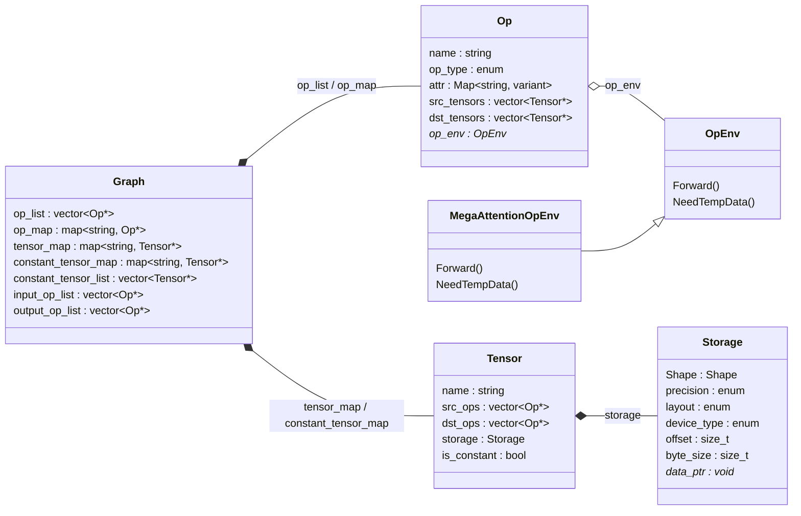

# Graph 模块设计

## 1. 模块定位

Graph 模块负责 C++ runtime IR、构图和图遍历。`Graph` 是该模块对外提供的核心类，持有模型拓扑、op、tensor、constant、输入输出和必要索引等 IR 公共成员，并定义构图、输入输出注册、排序和查询接口。Graph 不直接依赖底层 GPU/OCL 算子库，也不负责显存申请、shape / precision / layout 推导的具体策略。

Graph 构图完成后调用一次 `SortOp()` 整理 graph 内部 op 列表：从 graph 输出出发，沿 tensor 依赖关系执行 post DFS，将 graph op 按拓扑顺序放入 `op_list_`；constant 权重直接表示为 `Tensor`，作为数据依赖叶子，不进入执行序列。后续 Engine 初始化通过 `GetAllConstantTensor()` 处理权重，通过 `GetOrderlyOPList()` 消费执行序列，初始化阶段不再重复排序。

## 2. IR结构



Graph IR 的核心对象包括：

- `Graph`：保存整个模型或子图。
- `Op`：表示一次计算、输入、输出或 runtime 边界操作。
- `Tensor`：表示 op 之间的数据依赖边。
- `Storage`：描述 tensor 或 tempdata 的物理存储信息；constant 权重 storage 内嵌在 constant tensor 中。
- `GraphEnv`：保存 graph 级全局共享环境资源，例如 graph 内只需要一份的共享 buffer storage；Manager 统一为这些 storage 分配和回填 workspace。
- `OpEnv`：表示挂在 op 上的运行时执行环境；`MegaAttentionOpEnv` 是具体 op env 示例。

## 3. Graph 类设计

### 3.1 主要功能

`Graph` 是 runtime graph IR 的根对象，负责承载一个模型或子图的拓扑结构。它统一管理 op、普通 tensor、constant tensor、图输入输出、拓扑排序结果和 graph 级共享环境资源，并向模型加载模块、Engine 初始化流程和 Forward 流程提供稳定的 graph 查询接口。

Graph 只表达“图是什么”和“图中对象如何连接”，不直接执行底层 kernel，也不负责显存申请、通信初始化或具体 shape / precision / layout 推导策略。这些运行时工作分别由 Engine、Finalizer、Manager 和 OpEnv 完成。

### 3.2 类如何设计

`Graph` 设计为 C++ graph IR 核心类。公共接口用于构图、注册图边界、排序和查询；公共 IR 成员放在 `protected` 区域，便于后续扩展实现复用。跨模块访问优先通过明确接口完成，避免外部模块直接依赖内部容器细节。

Graph 内部使用 `map<string, unique_ptr<Op>>`、`map<string, unique_ptr<Tensor>>` 等容器持有 op、普通 tensor 和 constant tensor 的生命周期；执行序列、constant tensor 列表、输入 op 列表和输出 op 列表只保存裸指针，指向这些容器中已经创建好的对象，不负责释放对象。constant tensor 由 `constant_tensor_map_` 独立持有，不写入普通 `tensor_map_`。Graph 最后放置 `std::unique_ptr<GraphEnv> graph_env_`，用于保存 graph 级共享资源的 storage 元信息；Engine 初始化阶段通过 `CreateEnv()` 申请 GraphEnv 并创建 OpEnv，具体 OpEnv 通过 `OpEnv::Init()` 保存的 `graph_env_` 指针访问这些共享资源，Manager 通过 GraphEnv 遍历所有 share data 并统一规划 workspace。

```cpp
// Graph 是 runtime IR 的核心类，负责构图、图边界注册、拓扑排序和 IR 查询。
class Graph {
public:
    // 创建指定名称的 graph。
    explicit Graph(const std::string &name);

    // 返回 graph 名称。
    virtual const std::string &Name() const;

    // 创建普通计算 op，并返回该 op 创建出的输出 tensor。
    virtual Status CreateOp(
        const std::string &name,
        const std::vector<Tensor*> &src_tensors,
        size_t out_cnt,
        OpType op_type,
        const AttrMap &attr,
        std::vector<Tensor*> *outputs);

    // 创建 constant tensor，并把传入 storage 保存到 tensor 内。
    virtual Status CreateConstant(
        const std::string &name,
        const Storage &storage,
        Tensor **output);

    // 创建 graph 输入 op，并注册到 graph 输入列表；name 表示输入名称。
    virtual Status CreateInput(const std::string &name, Tensor **output);

    // 创建 graph 输出 op，并注册到 graph 输出列表；name 表示输出名称，input 表示输出依赖的 tensor。
    virtual Status CreateOutput(const std::string &name, Tensor *input);

    // 根据 graph 输出依赖整理 op 列表；constant tensor 作为依赖叶子，不进入 op_list_。
    virtual Status SortOp();

    // 返回所有 constant tensor。
    virtual const std::vector<Tensor*> &GetAllConstantTensor();

    // 返回所有输入 op。
    virtual const std::vector<Op*> &GetAllInputOp();

    // 返回所有输出 op。
    virtual const std::vector<Op*> &GetAllOutputOp();

    // 返回拓扑排序后的执行 op 序列。
    virtual const std::vector<Op*> &GetOrderlyOPList();

    // 设置 graph 级共享环境资源，并接管所有权。
    virtual Status SetGraphEnv(std::unique_ptr<GraphEnv> graph_env);

    // 返回 graph 级共享环境资源；未创建时返回 nullptr。
    virtual GraphEnv *GetGraphEnv();

    // 清理 graph 级共享环境资源。
    virtual void ClearGraphEnv();

    virtual ~Graph() = default;

protected:
    // 检查 tensor 指针是否由当前 graph 持有。
    bool OwnsTensor(const Tensor *tensor) const;

    std::string name_;
    std::vector<Op*> op_list_;
    std::vector<Tensor*> constant_tensor_list_;
    std::vector<Op*> input_op_list_;
    std::vector<Op*> output_op_list_;
    std::map<std::string, std::unique_ptr<Op>> op_map_;
    std::map<std::string, std::unique_ptr<Tensor>> tensor_map_;
    std::map<std::string, std::unique_ptr<Tensor>> constant_tensor_map_;
    std::unique_ptr<GraphEnv> graph_env_;
};
```

### 3.3 接口和成员含义

| C++ 接口 | Python wrapper | 参数 | 说明 |
|---|---|---|---|
| `Graph()` | - | `name`：graph 名称。 | 创建指定名称的 graph，并保存到 `name_`。 |
| `Name()` | - | 无。 | 返回 graph 名称。 |
| `CreateOp()` | `create_op()` | `name`：op 名称；`src_tensors`：输入 tensor 列表；`out_cnt`：输出 tensor 数量；`op_type`：op 类型；`attr`：op 属性；`outputs`：输出参数，返回创建出的输出 tensor。 | 创建普通计算 op 和输出 tensor；op 名称由 `Op` 构造函数保存，tensor 名称由 `Tensor` 构造函数保存。 |
| `CreateConstant()` | `create_constant()` | C++：`name`、`storage`、`output`；Python：`name`、`dims`、`pitch`、`precision`、`layout`、`byte_size`、`data_ptr`。 | C++ 接口创建 constant tensor，并将权重 storage 直接保存到该 tensor 内；Python wrapper 不暴露 `Storage`，而是在 wrapper 内由散装参数组装 storage。 |
| `CreateInput()` | `create_input()` | legacy：`name`、`output`；显式声明 overload：额外传 `precision`、`layout`。 | 创建 input op 和一个输出 tensor并注册图输入；legacy 给 Input attr 写默认 `Storage{}`，显式 overload 把 precision/layout 写入该 attr。Python `Tensor(..., dtype=..., is_input=True)` 通过 `mark_input(name, dtype)` 调用显式接口。 |
| `CreateOutput()` | `create_output()` | `name`：输出名称；`input`：输出依赖的输入 tensor。 | 创建 output op 并注册图输出；output op 没有输出 tensor，因此不调用 `CreateOp()`，也不写入 `tensor_map_`。 |
| `SortOp()` | `sort_op()` | 无。 | 从 graph 输出出发，沿 tensor 依赖关系执行 post DFS，将 graph op 按拓扑顺序放入 `op_list_`；constant tensor 作为依赖叶子，不要求 producer op。 |
| `GetAllConstantTensor()` | - | 无。 | 返回 graph 中所有由 `CreateConstant()` 创建的 constant tensor，供 Engine 初始化阶段加载权重。 |
| `GetAllInputOp()` | - | 无。 | 返回 graph 中所有输入 op 的列表，供输入绑定和初始化检查使用。 |
| `GetAllOutputOp()` | - | 无。 | 返回 graph 中所有输出 op 的列表，供输出绑定和初始化检查使用。 |
| `GetOrderlyOPList()` | - | 无。 | 返回 `SortOp()` 生成的 graph 拓扑排序 op 序列；调用方不能修改执行序列容器，但可通过 `Op*` 修改 op 内容。 |
| `SetGraphEnv()` | - | `graph_env`：Engine 创建出的 graph 级共享环境资源。 | 设置 graph 级共享环境资源，并接管所有权。 |
| `GetGraphEnv()` | - | 无。 | 返回 graph 级共享环境资源指针，未创建时返回 `nullptr`；供 Engine `CreateEnv()` 创建 OpEnv 时传入。 |
| `ClearGraphEnv()` | - | 无。 | 清理 graph 级共享环境资源，供 Engine `Uninit()` 反序释放环境时调用。 |
| - | `dump_ir()` | 无。 | Python binding 只读调试接口，返回 IR 文本，用于 Graph / 模型加载测试和人工确认；不暴露 `Op`、`Storage`、`Shape` 对象。 |

`CreateOp(name, src_tensors, out_cnt, op_type, attr, outputs)` 是普通算子的构图入口。它调用 `Op` 构造函数创建普通计算 op，由 `Op` 自己保存 `name`、`op_type` 和 `attr`；再根据 `out_cnt` 调用 `Tensor` 构造函数创建输出 tensor，由 `Tensor` 自己保存 tensor 名称；随后维护输入 tensor 到当前 op、当前 op 到输出 tensor 的连接关系，并把 op / tensor 注册到 graph 索引结构，最后通过 `outputs` 返回输出 tensor。

`CreateConstant(name, storage, output)` 是 C++ 权重常量构图入口。Python binding 不暴露 `Storage` / `Shape` 类型，Python 侧 `create_constant()` 传入权重名称、dims、pitch、precision、layout、byte size 和 CPU data pointer；pybind wrapper 内部组装 C++ `Storage` 后调用 `CreateConstant()`。C++ 侧创建名为 `name` 的 constant tensor，把传入 storage 直接保存到该 tensor 内，将 storage `reusable` 置为 false，并设置 `tensor->IsConstant()` 标记。constant tensor 不创建 producer op，由 `constant_tensor_map_` 独立持有，并追加到 `constant_tensor_list_`。权重常量作为图中的普通数据依赖被后续 op 消费，后续 OpEnv 从输入 tensor storage 读取权重地址和元信息。`Engine.Init()` 的 `RealizeConstantWeights()` 阶段会把 constant tensor storage 从 CPU 指针更新为 GPU 指针。

`CreateInput(name, output)` 是 legacy 图输入入口：C++ 创建 input op 和输出 tensor，给 Input op 写入默认 `attr["storage"] = Storage{}`，并登记到 `input_op_list_`。`CreateInput(name, precision, layout, output)` 复用同一拓扑创建过程，再把构图期 precision/layout 写入 Input attr；此时输出 tensor 仍保持默认 Storage，Finalizer 读取 attr 后才同步 tensor 元信息。Python `Tensor(name=..., dtype=..., is_input=True)` 由 `mark_input(name, dtype)` 调用显式 pybind overload，首版 layout 固定 dense；legacy 调用仍由 Engine Init 回退到 Int64/dense。

`CreateOutput(name, input)` 创建 output op 时写入默认 `attr["storage"] = Storage{}`。Input / Output op 的 `"storage"` attr key 是稳定边界属性；Input 还用它承载构图期 precision/layout 声明。Engine `SetInput()` / `SetOutput()` 在 Init 或 Forward 时覆盖 attr 的值，解绑时恢复为默认 `Storage{}`，不移除该 key。

`CreateOutput(name, input)` 是图输出的构图入口。output op 只消费已有 tensor，不产生新的 tensor，因此 C++ 侧手动创建 `OpType::kOutput` op，维护 `input -> output op` 的连接关系，注册到 `op_map_` 和 graph 输出列表，但不调用 `CreateOp()`，也不向 `tensor_map_` 写入输出 tensor。

`SortOp()` 以 `output_op_list_` 中登记的图输出为起点，沿 tensor 的 producer 依赖关系执行 post DFS。遍历过程中，graph op 按拓扑依赖顺序放入 `op_list_`，供初始化和 Forward 使用；遇到 `tensor->IsConstant()` 为 true 的 constant tensor 时，将其视为依赖叶子，不要求 `SrcOps()` 非空，也不压入 producer op。构图阶段 op 真正存放在 `op_map_` 中，`op_list_` 只保存排序整理后的非拥有指针。

Python binding 额外提供 `dump_ir()` 只读调试接口，内部读取 graph 排序结果并格式化成文本。该接口仅用于测试和人工确认，不作为 runtime 初始化的数据交换边界，也不向 Python 暴露 C++ `Op`、`Storage`、`Shape` 类型或返回这些对象的查询接口。

| 成员 | 类型 | 含义 |
|---|---|---|
| `name_` | `string` | graph 名称，用于调试和 graph_map 索引。 |
| `op_list_` | `vector<Op*>` | `SortOp()` 后生成的 graph 拓扑排序 op 序列，不拥有 op 生命周期。 |
| `constant_tensor_list_` | `vector<Tensor*>` | `CreateConstant()` 创建出的 constant tensor 列表，供 Engine 加载权重阶段遍历。 |
| `input_op_list_` | `vector<Op*>` | 图输入边界 op 列表；保留注册顺序，供输入绑定和初始化检查使用。 |
| `output_op_list_` | `vector<Op*>` | 图输出边界 op 列表；保留注册顺序，供输出绑定、初始化检查和 `SortOp()` 依赖遍历起点使用。 |
| `op_map_` | `map<string, unique_ptr<Op>>` | Graph 中持有 op 生命周期的容器，key 为 op 名称。 |
| `tensor_map_` | `map<string, unique_ptr<Tensor>>` | Graph 中持有 tensor 生命周期的容器，key 为 tensor 名称。 |
| `constant_tensor_map_` | `map<string, unique_ptr<Tensor>>` | Graph 中持有 constant tensor 生命周期的容器，key 为常量名称。 |

## 4. Op 类设计

### 4.1 主要功能

`Op` 表示 graph 中的一个节点，可以是普通计算、输入、输出或 runtime 边界操作。它记录自身类型、属性、输入输出 tensor 连接关系，以及 Engine 初始化后挂载的 `OpEnv`。

Op 不直接拥有 tensor，也不直接申请 runtime 显存。它通过 `src_tensors_` / `dst_tensors_` 描述数据依赖，通过 `attr_` 保存算子静态属性，通过 `op_env_` 持有具体执行环境。

### 4.2 类如何设计

`Op` 作为 Graph 内部对象由 `Graph::op_map_` 统一持有生命周期。Graph 构图阶段通过 `Op` 构造函数创建 Op，并在构造时设置 `name_`、`op_type_` 和 `attr_`；随后 Graph 把相关 tensor 连接到 Op。Engine 初始化阶段根据 `op_type_` 为普通计算 op 创建对应 `OpEnv`。

```cpp
// Op 表示 graph 中的一个计算节点或边界节点。
class Op {
public:
    // 创建指定名称、类型和属性的 op。
    Op(const std::string &name, OpType op_type, const AttrMap &attr);

    // 返回 op 名称。
    const std::string &Name() const;

    // 返回 op 类型。
    OpType Type() const;

    // 返回 op 属性。
    const AttrMap &Attrs() const;

    // 设置 op 属性。
    Status SetAttr(const std::string &attr_name, const AttrValue &value);

    // 返回输入 tensor 列表。
    const std::vector<Tensor*> &SrcTensors() const;

    // 返回输出 tensor 列表。
    const std::vector<Tensor*> &DstTensors() const;

    // 绑定 runtime 执行环境并接管所有权。
    Status SetOpEnv(std::unique_ptr<OpEnv> op_env);

    // 清理 runtime 执行环境。
    void ClearOpEnv();

    // 返回 runtime 执行环境。
    OpEnv *GetOpEnv() const;

private:
    friend class Graph;

    // 添加输入 tensor 连接。
    void AddSrcTensor(Tensor *tensor);

    // 添加输出 tensor 连接。
    void AddDstTensor(Tensor *tensor);

    std::string name_;
    OpType op_type_ = OpType::kUnknown;
    AttrMap attr_;
    std::vector<Tensor*> src_tensors_;
    std::vector<Tensor*> dst_tensors_;
    std::unique_ptr<OpEnv> op_env_;
};
```

### 4.3 接口和成员含义

| 接口 | 参数 | 说明 |
|---|---|---|
| `Op()` | `name`：op 名称；`op_type`：op 类型；`attr`：op 属性。 | 创建 op，并初始化 `name_`、`op_type_` 和 `attr_`。 |
| `Name()` | 无。 | 返回 op 名称，用于 graph 索引、日志和调试。 |
| `Type()` | 无。 | 返回 op 类型，Engine 初始化时据此选择对应 `OpEnv`。 |
| `Attrs()` | 无。 | 返回 op 属性，供 Finalizer、Manager 或 OpEnv 读取算子静态配置。 |
| `SetAttr()` | `attr_name`：属性名；`value`：属性值。 | 设置 op 属性，供 Engine 在运行期用输入输出绑定 storage 覆盖 Input / Output op 的 `attr["storage"]`。 |
| `SrcTensors()` | 无。 | 返回输入 tensor 列表。 |
| `DstTensors()` | 无。 | 返回输出 tensor 列表。 |
| `SetOpEnv()` | `op_env`：runtime 执行环境 unique_ptr。 | 绑定 Engine 初始化阶段创建的 op env，并接管对象所有权。 |
| `ClearOpEnv()` | 无。 | 释放已绑定的 op env，供 Engine `Uninit()` 反初始化流程调用。 |
| `GetOpEnv()` | 无。 | 返回已绑定的 op env，Forward 阶段调用其执行入口。 |

| 成员 | 类型 | 含义 |
|---|---|---|
| `name_` | `string` | op 名称，用于 graph 索引和调试。 |
| `op_type_` | `enum` | op 类型，如 input、output、attention、linear、rmsnorm、moe、gather、add、add_rmsnorm、ffn 等。 |
| `attr_` | `Map<string, variant>` | op 属性，只保存图结构和执行所需的算子属性。 |
| `src_tensors_` | `vector<Tensor*>` | 输入 tensor。 |
| `dst_tensors_` | `vector<Tensor*>` | 输出 tensor。 |
| `op_env_` | `unique_ptr<OpEnv>` | runtime 初始化后创建的算子执行环境，由 Op 持有生命周期。 |

`op_type` 决定 `Engine.Init()` 阶段应创建哪一种 `OpEnv`。普通计算 op 的 `attr_` 保存静态或半静态属性，例如 RMSNorm 的 `eps`、attention 的 head 配置、axis、是否 causal 等。权重名称、host/device 大块内存和 runtime buffer 不由普通计算 op 的 `attr_` 承载，应通过 constant tensor 的 `Storage` 或显存管理模块管理。Input / Output op 例外：构图时会预置 `attr["storage"] = Storage{}`；Engine 的 `SetInput()` / `SetOutput()` 会覆盖该值，供 InputOpEnv / OutputOpEnv 在 Forward 阶段读取；解绑时恢复默认值。

### 4.4 OpType 设计

`OpType` 表示 graph 节点类型，用于模型加载阶段构图、Engine 初始化阶段选择 `OpEnv`，以及日志和调试输出。枚举值遵循 C++ scoped enum 风格，成员名以 `k` 开头。

```cpp
// OpType 表示 graph 中 op 的类型。
enum class OpType {
    kUnknown,
    kInput,
    kOutput,
    kMegaAttention,
    kLinear,
    kLinearRmsNorm,
    kLinearRmsNormRope,
    kLinearRmsNormRopeQuantPagedKVStore,
    kLinearRopeRotateQuant,
    kLinearMul,
    kLinearApe,
    kRmsNorm,
    kRmsNormRopeQuantPagedKVStore,
    kRopeQuantLinear,
    kMegaMoe,
    kDeepseekV3Router,
    kHashRouter,
    kScoreRouter,
    kLinearSwiGlu,
    kGather,
    kExpandEmbedding,
    kAdd,
    kAddRmsNorm,
    kFfn,
    kHcPre,
    kHcPost,
    kHcHead,
    kRope,
    kSparseMla,
    kQuant,
    kRotate,
    kKvCompress,
    kIndexScore,
    kTopK,
    kReshape,
    kPack,     // pack [B,S_max,*rest] -> [M,*rest] by input_start_index (gather valid tokens)
    kUnpack,   // unpack [M,*rest] -> [B,S_max,*rest] by input_start_index (scatter + pad 0)
};

// 返回 op 类型对应的字符串名称。
const char *OpTypeToStr(OpType op_type);
```

| 接口 / 枚举 | 含义 |
|---|---|
| `kInput` / `kOutput` | graph 输入输出边界 op。 |
| `kMegaAttention` | MegaAttention 大粒度融合算子，覆盖 attention / MLA / KV cache 相关路径。 |
| `kLinear` | linear 算子，对应底层 GEMM 路径。 |
| `kLinearRmsNorm` / `kLinearRmsNormRope` / `kLinearRmsNormRopeQuantPagedKVStore` | DeepSeek V4 Tcore-Vcore 构图使用的 Q/KV path 通用融合 op。 |
| `kLinearRopeRotateQuant` / `kLinearMul` / `kLinearApe` | DeepSeek V4 Tcore-Vcore indexer / compressor 前段使用的通用融合 op。 |
| `kRmsNorm` | RMSNorm 算子。 |
| `kRmsNormRopeQuantPagedKVStore` / `kRopeQuantLinear` | DeepSeek V4 Tcore-Vcore compressor 后段和 output path 使用的通用融合 op。 |
| `kMegaMoe` | MegaMoe 大粒度融合算子，覆盖 routed expert 的 dispatch / grouped GEMM / combine 路径，不包含 router 和 shared expert。 |
| `kDeepseekV3Router` / `kHashRouter` / `kScoreRouter` | MoE 路由融合 op，分别覆盖 DeepSeek V3 router、DeepSeek V4 hash layer tie2eid 路径和 V4 普通 score+bias+topk 路径。 |
| `kLinearSwiGlu` | Expert / shared expert 的 gate + up + SwiGLU 前段融合 op。 |
| `kGather` | gather 算子。 |
| `kExpandEmbedding` | DeepSeek V4 使用的 embedding lookup + HC 维展开融合算子。 |
| `kAdd` | add 算子。 |
| `kAddRmsNorm` | add + RMSNorm 融合算子。 |
| `kFfn` | FFN 相关融合算子。 |
| `kHcPre` / `kHcPost` / `kHcHead` | DeepSeek V4 Hyper-Connections 相关 op。 |
| `kRope` / `kQuant` / `kRotate` / `kReshape` | DeepSeek V4 attention 拆分后的基础变换 op。 |
| `kSparseMla` | DeepSeek V4 sparse MLA attention 内核 op。 |
| `kKvCompress` / `kIndexScore` / `kTopK` | DeepSeek V4 compressor / indexer 路径使用的 domain op 和通用 top-k op。 |
| `OpTypeToStr()` | 将 `OpType` 转为稳定字符串，供日志、错误信息和调试输出使用。 |

## 5. Tensor 类设计

### 5.1 主要功能

`Tensor` 表示 op 之间的数据依赖边。它连接 producer op 和 consumer op，并携带该 tensor 对应的 `Storage` 描述，使 Finalizer、Manager 和 OpEnv 能够围绕同一个数据对象完成 shape / precision / layout 推导、显存规划和底层算子调用。

Tensor 不拥有计算逻辑，也不直接决定显存分配策略。它只记录数据流关系和物理存储描述，是 graph 拓扑分析和 workspace 生命周期分析的基础对象。

### 5.2 类如何设计

普通 activation tensor 由 `Graph::tensor_map_` 持有生命周期，constant tensor 由 `Graph::constant_tensor_map_` 持有生命周期。Graph 构图阶段通过 `Tensor` 构造函数创建 Tensor，并在构造时设置 `name_`。普通计算 op 创建输出 tensor，`CreateConstant()` 创建 constant tensor，输入输出边界 op 通过 tensor 与后续计算节点连接。Tensor 内嵌 `Storage`，workspace tensor 的 `Storage.data_ptr` 在显存规划和 realize 后指向 workspace GPU 地址；constant tensor 的 storage 在权重加载后指向 GPU 权重地址。

```cpp
// Tensor 表示 graph 中的数据边，并承载对应 storage 描述。
class Tensor {
public:
    // 创建指定名称的 tensor。
    explicit Tensor(const std::string &name);

    // 返回 tensor 名称。
    const std::string &Name() const;

    // 返回 producer op 列表。
    const std::vector<Op*> &SrcOps() const;

    // 返回 consumer op 列表。
    const std::vector<Op*> &DstOps() const;

    // 返回 tensor 的 storage。
    Storage &GetStorage();

    // 返回 tensor 的只读 storage。
    const Storage &GetStorage() const;

    // 返回 tensor storage 是否允许参与 workspace 复用。
    bool Reusable() const;

    // 设置 tensor storage 是否允许参与 workspace 复用。
    void SetReusable(bool reusable);

    // 返回 tensor 是否为 constant 权重 tensor。
    bool IsConstant() const;

private:
    std::string name_;
    std::vector<Op*> src_ops_;
    std::vector<Op*> dst_ops_;
    Storage storage_;
    int ref_count_;
};
```

### 5.3 接口和成员含义

| 接口 | 参数 | 说明 |
|---|---|---|
| `Tensor()` | `name`：tensor 名称。 | 创建 tensor，并初始化 `name_`。 |
| `Name()` | 无。 | 返回 tensor 名称，用于 graph 索引、日志和调试。 |
| `SrcOps()` | 无。 | 返回 producer op 列表，普通 tensor 通常只有一个 producer。 |
| `DstOps()` | 无。 | 返回 consumer op 列表，供遍历、依赖分析和生命周期分析使用。 |
| `GetStorage()` | 无。 | 返回 tensor storage，供推导、显存规划和 OpEnv 执行阶段读取或更新。 |
| `Reusable()` | 无。 | 返回 `storage_.reusable`，表示 tensor 的物理内存是否允许参与 workspace 复用。 |
| `SetReusable()` | `reusable`：是否允许复用。 | 写入 `storage_.reusable`，用于显式标记 tensor workspace 生命周期。 |

| 成员 | 类型 | 含义 |
|---|---|---|
| `name_` | `string` | tensor 名称。 |
| `src_ops_` | `vector<Op*>` | 产生该 tensor 的上游 op，普通 tensor 通常只有一个 producer。 |
| `dst_ops_` | `vector<Op*>` | 消费该 tensor 的下游 op。 |
| `storage_` | `Storage` | tensor 内嵌的物理存储描述。 |
| `ref_count_` | `int` | workspace 规划期用于生命周期分析的消费者引用计数。 |
| `is_constant_` | `bool` | 标记该 tensor 是否为 constant 权重 tensor。 |

Tensor 不直接拥有计算逻辑。它承接 graph 数据流，提供依赖分析、生命周期分析和显存复用分析所需的信息。

## 6. Storage 结构体设计

### 6.1 主要功能

`Storage` 描述 tensor、constant 或 tempdata 的物理存储信息，包括 shape、precision、layout、workspace offset、byte size、data pointer 和是否允许复用。它是 Finalizer 推导结果、Manager 显存规划结果和 OpEnv 底层算子调用参数之间的共同载体。

### 6.2 结构体如何设计

`Storage` 是只保存数据描述的结构体，不定义复杂行为。它内嵌在 Tensor 中，也用于 OpEnv tempdata。模型加载完成后，constant tensor storage 可以临时指向 Python torch tensor 持有的 CPU 权重；`Engine.Init()` 的 `RealizeConstantWeights()` 阶段会为 constant 申请 GPU 显存，拷贝权重，并把 constant tensor storage 的 `data_ptr` 更新为 GPU 地址。

```cpp
// Storage 描述 tensor 或 constant 的物理存储信息。
struct Storage {
    Shape shape;
    Precision precision;
    Layout layout;
    DeviceType device_type;
    size_t offset;
    size_t byte_size;
    void *data_ptr;
    bool reusable;
};
```

### 6.3 成员含义

| 成员 | 类型 | 含义 |
|---|---|---|
| `shape` | `Shape` | tensor 维度。 |
| `precision` | `enum` | 数据精度，如 FP16、BF16、FP8、INT 等。 |
| `layout` | `enum` | 数据 layout，需满足底层算子库要求。 |
| `device_type` | `enum` | 当前 `data_ptr` 所在设备类型；constant tensor 在构图后通常为 CPU，`RealizeConstantWeights()` 后更新为目标 device type，Uninit 释放 device 权重后恢复为 CPU。 |
| `offset` | `size_t` | workspace buffer 中的逻辑偏移。 |
| `byte_size` | `size_t` | 当前 storage 对应的字节数，供权重加载和显存规划申请真实显存。 |
| `data_ptr` | `void*` | 实际数据地址。constant tensor storage 在模型加载后可暂时指向 Python torch tensor 持有的 CPU 权重，在 `Engine.Init()` 的 `RealizeConstantWeights()` 后必须指向 GPU 权重；workspace tensor 在 realize 后指向 workspace GPU 地址。 |
| `reusable` | `bool` | 标记该 storage 是否允许参与 workspace 复用；tensor 和 tempdata 都通过该字段表达复用属性，默认可复用，constant tensor storage 在 `CreateConstant()` 中置为不可复用。 |

Storage 是 IFinalizer 推导、IManager 显存规划和 OpEnv 调用底层算子 API 之间的共同载体。OpEnv 执行时从输入输出 tensor 的 storage 中读取 shape、precision、layout 和 data pointer，组装底层算子需要的描述符。

## 7. Shape 结构体设计

### 7.1 主要功能

`Shape` 描述 tensor 的逻辑维度和物理 pitch。逻辑维度用于 shape 推导和元素数量计算；pitch 描述每个维度实际占用的物理大小，用于需要按物理布局估算存储大小的场景。

### 7.2 结构体如何设计

`Shape` 使用长度为 `kMaxShapeDim` 的定长数组保存 `dims` 和 `pitch`，默认值均为 1；`max_dim` 表示实际有效维度数量，放在数组成员之后。

```cpp
// Shape 描述 tensor 的逻辑维度和物理 pitch。
struct Shape {
    // 返回逻辑 shape 的元素数量。
    int64_t GetShapeSize() const;

    // 返回物理 pitch 对应的元素数量。
    int64_t GetByteSize() const;

    std::array<int64_t, kMaxShapeDim> dims;
    std::array<int64_t, kMaxShapeDim> pitch;
    int64_t max_dim;
};
```

### 7.3 接口和成员含义

| 接口 / 成员 | 类型 | 含义 |
|---|---|---|
| `GetShapeSize()` | `int64_t` | 将 `dims[0, max_dim)` 中的维度相乘，返回逻辑元素数量。 |
| `GetByteSize()` | `int64_t` | 将 `pitch[0, max_dim)` 中的维度相乘，返回物理 pitch 对应的元素数量。 |
| `dims` | `array<int64_t, kMaxShapeDim>` | 逻辑维度数组，默认每一维为 1。 |
| `pitch` | `array<int64_t, kMaxShapeDim>` | 物理维度数组，默认每一维为 1。 |
| `max_dim` | `int64_t` | 实际有效维度数量。 |